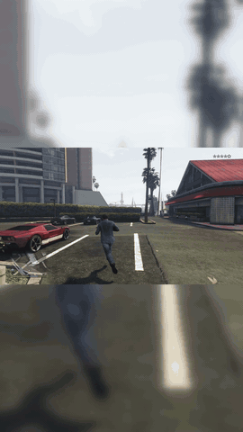

# gta-clipper

Finds the action in a GTA V gameplay recording (PS5 captures) and cuts it into vertical 1080x1920 clips of 15-30 s for
Shorts.

<!-- Demo video: the MP4 is uploaded with GitHub's web editor; its link goes on the line below this comment. -->



*Default output of current main on test1: clip 4 of 5, 2:16.0-2:46.0 of the source, rated postable. The GIF shows 6 s
of it (2:32.0-2:38.0, around the clip's peak at 2:35.0).*

## Result

| Postable@5 (out of 10) | Dev: test1 + test2 | Held-out: heldout1 + heldout2 |
|---|---|---|
| `--vlm off` (no vision model) | 8 | 5 |
| The frozen vision-model config (4b v3 + star rule) | 8 | 5 |
| 4b + stars, the only config that did worse than off | 8 | 4 |

Postable@5 is how many of the first 5 clips per video I rated postable ([How I measured](#how-i-measured)).

- **The vision-model step added nothing on held-out.** The frozen config made exactly the clips that `--vlm off` made,
  on both held-out videos (same rank, start, end and peak). It spent 69.4 s of model time and 15.0 s of contact sheets
  doing that. Of the six vision-model configs, five equal off and one did worse (4b + stars, 4 of 10).
- **Dev is in-sample.** The rules were tuned on test1 and test2, and every config scored 8 of 10 there, so dev
  Postable@5 can't tell the configs apart.
- **Held-out 5 of 10 includes an empty slot.** heldout2 made only 4 clips, and the missing 5th counts as not postable:
  5 postable of 9 clips made.
- **This is weak evidence.** 14 rated held-out clips from 2 videos, and heldout2 has only about 22.5 s of action. Why
  held-out scored lower than dev was not tested.

Details: [eval/BASELINE.md, v8](eval/BASELINE.md#v8-the-one-time-held-out-test-2026-10-24).

## How I measured

Four PS5 recordings: test1 (15:24.7) and test2 (20:49.7) are the dev set, and the rules were tuned on them.
heldout1 (15:18.7) and heldout2 (5:59.0) were used once, for the held-out test.

- **Answer keys** (`eval/answer_keys/`, one per video): `action` ranges (shootouts, chases, crashes, carjacks, driving
  with wanted stars) and `never_pick` ranges (pause maps, cutscenes, phone calls, shop menus). `eval.py` scores a run
  against them: strict hits (at least 50 % of a clip inside action ranges), recall, and bad picks (clips that touch a
  never-pick range).
  - test1 and test2: drafted from contact sheets (one frame every 10 s, with pause-map, phone-call and cutscene edges
    checked on finer sheets), confirmed by me on 2026-10-22, then revised twice from 0.5 s frames. Each key lists its
    revisions and their frame evidence.
  - heldout1 and heldout2: drafted by Claude from video frames (10 s, 2.5 s, and 0.5 s at every edge). I answered five
    policy questions and accepted the ranges, but did not check them frame by frame.
- **Postable@5**, from my ratings: of the first 5 clips per video, how many I rated postable, out of 5. An unrated clip
  counts as not postable. Each rating is postable or not, with a reason.
  - I rated the 14 held-out clips blind, on a page with no scores, ranks, configs or model verdicts
    (`make_rating_page.py`), before any vision-model run.
  - I rated the dev clips on the review sheet, which shows scores and ranks, so those ratings are not blind.
- **The vision model as a judge**, on every candidate clip I rated: a *costly veto* is a clip I rated postable that the
  model threw out; *kept but not postable* is a clip I rejected that the model let through.
- **A pre-registered, one-time held-out test.** The plan, including the rule that picks the final config from dev
  results, was written before the held-out videos were opened ([eval/HELDOUT_PLAN.md](eval/HELDOUT_PLAN.md)). The config
  was frozen in commit `6e0a9f3`, and then each config ran once per video. Nothing in the code, prompts, thresholds or
  keys changed after a held-out clip was seen. The deviations from the plan are listed in
  [BASELINE v8](eval/BASELINE.md#deviations-from-the-plan).
- Since that test, heldout1 and heldout2 count as dev data; a new claim needs new footage.

Details: [the Postable@5 rules (PR 5)](eval/BASELINE.md#pr-5-eval-fixes-and-postable5-2026-10-23),
[keys and blind ratings](eval/BASELINE.md#keys-and-blind-ratings).

## What worked

- **Reading the HUD (v2, v3).** The tool takes small crops of GTA V's on-screen HUD. No minimap for 1.5 s or more means
  a pause map, cutscene or menu, and no clip may touch it; wanted stars add to the score; the phone's call screen is cut
  out. On dev, bad picks went from 4 in v1 (two phone calls, a pause map, a cutscene) to 1 in v2 and 0 in v3.
  - On held-out all 16 runs had 0 bad picks, against keys I didn't check frame by frame. Two of heldout1's never-pick
    stretches (the walk inside the Ammu-Nation shop and the Mission passed overlay) show the minimap, so the HUD rules
    didn't exclude them; no clip went there.
  - The cost: the phone rule removed a crash I had rated postable (test2 19:07.5, the car hits a lamp post while the
    phone's call screen is still up). That stretch has had no clip since v3.
- **Cutting each clip to the action (v4), with a 15 s minimum.** A clip runs from 1.0 s before the action to 1.5 s after
  it, 15-30 s long. I set the 15 s minimum after rating 8 s clips, two of which were "too short". On dev, Postable@5
  went from 7 to 8 of 10 (test1 4/5 to 5/5; test2 3/5 both times), and test1's recall from 4/5 to 5/5.
  - The +1 is one clip. v3 cut the moment around 2:35.0 as 2:26.0-2:46.0, which I rated "boring, bad cut"; v4 cut it as
    2:16.0-2:46.0, which I rated postable. That is the demo clip above. Dev only, and not blind.
- **GPU decoding (v3).** Decoding on the GPU (NVDEC) cut a whole run from 232.20 s to 81.24 s on test1 and from
  297.20 s to 87.34 s on test2. `timeline.csv` was byte-identical to the CPU run's on both videos.

Details: [v1](eval/BASELINE.md#v1-baseline-2026-10-22),
[v2](eval/BASELINE.md#v2-hud-aware-scoring-compared-with-the-baseline-2026-10-22),
[v3](eval/BASELINE.md#v3-strict-eval-owner-ratings-spread-phone-gpu-decoding-compared-2026-10-22),
[the lamp-post crash](eval/BASELINE.md#the-lamp-post-crash-test2-19075-19095),
[v4 at 15 s](eval/BASELINE.md#v4-with-a-15-s-minimum-2026-10-23),
[v3 and v4 rescored (PR 5)](eval/BASELINE.md#results-dev-set).

## What failed

The idea: before a candidate becomes a clip, a local vision model (Qwen3-VL 4B or 8B Instruct, through Ollama) looks at
8 frames of it and may veto it as boring, a clumsy crash or a menu. It is off by default (`--vlm`).

- **The veto itself (PR 6).** On the 12 rated dev candidates, with the final prompt (v3), the 4b vetoed 3 clips I rated
  postable. All three had at least 27.5 s of measured wanted stars, and it called them boring (one is the demo clip).
  The 8b vetoed no rated clip, so it also kept both clumsy crashes I rejected. Postable@5 didn't change with either model. None
  of the three prompt versions allowed met the stopping rule (neither model vetoing a clip I rated postable). Model time
  per video: 45.0-46.6 s for the 4b, 64.0-66.4 s for the 8b.
- **Telling the model the wanted stars as text (PR 7).** The tool already measures the stars, so the prompt got a line
  such as "Measured by the tool: wanted stars visible for 27.5 of 30.0 s." The 4b still called clips with 27.5-30 s of
  measured stars boring. With the final hint prompt it made 4 costly vetoes and kept 2 rejected clips (3 and 0 without
  the hint); the first hint prompt made it veto all 10 test2 candidates, 3 of them postable.
  - A code rule instead (cancel a "boring" veto when the clip has 5.0 s or more of stars) made no mistake on the 12 dev
    candidates. But it was written after the 4b's three dev mistakes were known, so that result is in-sample.
- **The held-out test (PR 8).** The frozen config was the 4b with that star rule. On held-out it made 2 costly vetoes
  (dev: 0) and kept 4 of the 5 clips I rejected (dev: 0 of 2).
  - The star rule changed 2 verdicts, both from agreeing with me to disagreeing: it kept two police chases I had
    rejected ("crashing a lot"; the other with no reason given).
  - No vision-model config had 0 costly vetoes on held-out. 10 of the 11 costly vetoes over all configs were plain
    drives with no wanted stars that I rated postable.
  - One of my rejections was "repetitive", a judgement about the whole set of clips that a veto of one clip at a time
    can't make.

Details: [v6](eval/BASELINE.md#v6-local-vision-model-veto-2026-10-24),
[v7](eval/BASELINE.md#v7-measured-wanted-stars-for-the-veto-2026-10-24),
[v8, every candidate and verdict](eval/BASELINE.md#table-c-every-candidate-and-every-verdict),
[every prompt version](prompts/LOG.md).

## Next

GTA 6 HUD support, once there is GTA 6 footage. The HUD rules only know GTA V's PS5 layout; GTA 6 will need new crop
boxes and new detectors.

## How it was built

Built with Claude Code. I (Udit) designed the evals, rated every clip, and made the decisions at each step.

## How to run

Tested on Windows 11 with Python 3.14.7 and ffmpeg/ffprobe on PATH (the Gyan "full" build 9.0). Standard library only,
so there is nothing to pip install. An NVIDIA GPU is used for decoding and encoding when it works, but isn't required.
Ollama is needed only for `--vlm`.

```powershell
python -m venv .venv
.\.venv\Scripts\python.exe clip.py C:\path\to\recording.mp4       # 5 clips, 15-30 s each
.\.venv\Scripts\python.exe eval.py C:\AI\gta\output\test1\<run>   # score a run against its answer key
.\.venv\Scripts\python.exe selftest.py                            # builds a synthetic video and checks the clips
```

Each run writes its clips, `scores.json` and `timeline.csv` to `C:\AI\gta\output\<video>\<YYYYMMDD-HHMMSS>\` (`--out`
changes the root). The test videos are not in the repo. Every flag, the output files, the HUD rules, the vision-model
stage and the known limits are in [docs/DETAILS.md](docs/DETAILS.md); every result is in
[eval/BASELINE.md](eval/BASELINE.md).
