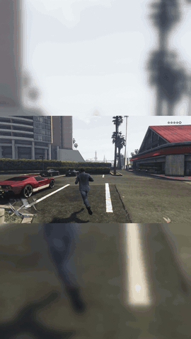

# gta-clipper

- **What it does:** it finds the action in a GTA V gameplay recording (PS5 captures) and cuts it into vertical
  1080x1920 clips of 15-30 s for Shorts, automatically.
- **How I measured it:** before improving the tool, I built a way to score it: a list of where the action is (and where
  a clip must never go) in each video, and my own "would I post this?" rating of each clip.
- **What didn't help:** a local vision model, added to throw out bad clips. On two new videos, the setup I had chosen in
  advance made exactly the same clips as the tool without it (one other setup did worse). A simple code rule fixed the
  model's 3 mistakes on the videos I tuned on, but I wrote it after seeing those mistakes, and on the new videos it
  turned 2 of the model's right calls into wrong ones.
- **Final result:** on the two new videos, 5 of the top 10 clips were ones I would post (one video gave only 4 clips,
  and the empty slot counts as a miss). On the two videos the tool was tuned on: 8 of 10.

<!-- Demo video: the MP4 is uploaded with GitHub's web editor; its link goes on the line below this comment. -->
https://github.com/user-attachments/assets/4c7f8082-6576-4eb1-9233-058405f441fa




*Output on test1 with `--spread v9`, the default before v10: clip 4 of 5, 2:16.0-2:46.0 of the source, rated postable. The GIF shows 6 s
of it (2:32.0-2:38.0, around the clip's peak at 2:35.0).*

## Result

| Postable@5 (out of 10) | Dev: test1 + test2 | Held-out: heldout1 + heldout2 |
|---|---|---|
| `--vlm off` (no vision model) | 8 | 5 |
| The frozen vision-model config (4b v3 + star rule) | 8 | 5 |
| 4b + stars, the only config worse than off on held-out | 8 | 4 |

Postable@5 is how many of the first 5 clips per video I rated postable ([How I measured](#how-i-measured)).

- **The vision-model step added nothing on held-out.** The frozen config made exactly the clips that `--vlm off` made,
  on both held-out videos (same rank, start, end and peak). It costs 69.4 s of model time (its 4b v3 answers) and
  15.0 s of contact sheets over the two videos, and changed no clip. Of the six vision-model configs, five equal off and
  one did worse (4b + stars, 4 of 10).
- **Dev is in-sample.** The rules were tuned on test1 and test2, and every config scored 8 of 10 there, so dev
  Postable@5 can't tell the configs apart.
- **Held-out 5 of 10 includes an empty slot.** heldout2 made only 4 clips, and the missing 5th counts as not postable:
  5 postable of 9 clips made.
- **This is weak evidence.** 14 rated held-out clips from 2 videos, and heldout2 has only about 22.5 s of action. Why
  held-out scored lower than dev was not tested.

Details: [eval/BASELINE.md, v8](eval/BASELINE.md#v8-the-one-time-held-out-test-2026-10-24).

## How I measured

Four GTA V recordings: test1 (15:24.7) and test2 (20:49.7) are the dev set, and the rules were tuned on them.
heldout1 (15:18.7) and heldout2 (5:59.0) were used once, for the held-out test.

- **Answer keys** (`eval/answer_keys/`, one per video): `action` ranges (shootouts, chases, crashes, carjacks, driving
  with wanted stars) and `never_pick` ranges (pause maps, cutscenes, phone calls, shop menus). `eval.py` scores a run
  against them: strict hits (at least 50 % of a clip inside action ranges), recall, and bad picks (clips that touch a
  never-pick range).
  - test1 and test2: drafted from contact sheets (one frame every 10 s, with pause-map, phone-call and cutscene edges
    checked on finer sheets), confirmed by me on 2026-10-22, then revised twice from 0.5 s frames. Each key lists its
    revisions and their frame evidence.
  - heldout1 and heldout2: drafted by Claude from video frames (10 s, 2.5 s, and 0.5 s at every edge). I answered five
    policy questions and accepted the ranges, but did not check them frame by frame.
- **Postable@5**, from my ratings: of the first 5 clips per video, how many I rated postable, out of 5. An unrated clip
  counts as not postable. Each rating is postable or not, with a reason.
  - I rated the 14 held-out clips blind, on a page with no scores, ranks, configs or model verdicts
    (`make_rating_page.py`), before any vision-model run.
  - I rated the dev clips on the review sheet, which shows scores and ranks, so those ratings are not blind.
- **The vision model as a judge**, on every candidate clip I rated: a *costly veto* is a clip I rated postable that the
  model threw out; *kept but not postable* is a clip I rejected that the model let through.
- **A pre-registered, one-time held-out test.** The plan, including the rule that picks the final config from dev
  results, was written before the held-out videos were opened ([eval/HELDOUT_PLAN.md](eval/HELDOUT_PLAN.md)). The config
  was frozen in commit `6e0a9f3`, and then each config ran once per video. Nothing in the code, prompts, thresholds or
  keys changed after a held-out clip was seen. The deviations from the plan are listed in
  [BASELINE v8](eval/BASELINE.md#deviations-from-the-plan).
- Since that test, heldout1 and heldout2 count as dev data; a new claim needs new footage.

Details: [the Postable@5 rules (PR 5)](eval/BASELINE.md#pr-5-eval-fixes-and-postable5-2026-10-23),
[keys and blind ratings](eval/BASELINE.md#keys-and-blind-ratings).

## What worked

- **Reading the HUD (v2, v3).** The tool takes small crops of GTA V's on-screen HUD. No minimap for 1.5 s or more means
  a pause map, cutscene or menu, and no clip may touch it; wanted stars add to the score; the phone's call screen is cut
  out. On dev, bad picks went from 4 in v1 (two phone calls, a pause map, a cutscene) to 1 in v2 and 0 in v3.
  - On held-out all 16 runs had 0 bad picks, against keys I didn't check frame by frame. Two of heldout1's never-pick
    stretches (the walk inside the Ammu-Nation shop and the Mission passed overlay) show the minimap, so the HUD rules
    didn't exclude them; no clip went there.
  - The cost: the phone rule removed a crash I had rated postable (test2 19:07.5, the car hits a lamp post while the
    phone's call screen is still up). That stretch has had no clip since v3.
- **Cutting each clip to the action (v4), with a 15 s minimum.** A clip runs from 1.0 s before the action to 1.5 s after
  it, 15-30 s long. I set the 15 s minimum after rating 8 s clips, two of which were "too short". On dev, Postable@5
  went from 7 to 8 of 10 (test1 4/5 to 5/5; test2 3/5 both times), and test1's recall from 4/5 to 5/5.
  - The +1 is one clip. v3 cut the moment around 2:35.0 as 2:26.0-2:46.0, which I rated "boring, bad cut"; v4 cut it as
    2:16.0-2:46.0, which I rated postable. That is the demo clip above. Dev only, and not blind.
- **GPU decoding (v3).** Decoding on the GPU (NVDEC) cut a whole run from 232.20 s to 81.24 s on test1 and from
  297.20 s to 87.34 s on test2. `timeline.csv` was byte-identical to the CPU run's on both videos.
- **Spreading the clips across the video (v10), a trade-off.** A short stretch with no minimap no longer ends an action sequence, so
  a chase can't use one to get past the limit of 2 clips per sequence. On a 25:04 recording the clips went from one
  5-minute block to four. Postable@5 is unchanged on all 6 recordings (the 4 above and 2 with no answer key). test1's
  strict hits and recall both fell from 5/5 to 4/5. I made it the default because I rated 2 of the 3 clips it adds on
  the 25:04 recording postable.

Details: [v1](eval/BASELINE.md#v1-baseline-2026-10-22),
[v2](eval/BASELINE.md#v2-hud-aware-scoring-compared-with-the-baseline-2026-10-22),
[v3](eval/BASELINE.md#v3-strict-eval-owner-ratings-spread-phone-gpu-decoding-compared-2026-10-22),
[the lamp-post crash](eval/BASELINE.md#the-lamp-post-crash-test2-19075-19095),
[v4 at 15 s](eval/BASELINE.md#v4-with-a-15-s-minimum-2026-10-23),
[v3 and v4 rescored (PR 5)](eval/BASELINE.md#results-dev-set),
[v10](eval/BASELINE.md#v10-spreading-picks-across-the-video-2026-11-04).

## What failed

The idea: before a candidate becomes a clip, a local vision model (Qwen3-VL 4B or 8B Instruct, through Ollama) looks at
8 frames of it and may veto it as boring, a clumsy crash or a menu. It is off by default (`--vlm`).

- **The veto itself (PR 6).** On the 12 rated dev candidates, with the final prompt (v3), the 4b vetoed 3 clips I rated
  postable. All three had at least 27.5 s of measured wanted stars, and it called them boring (one is the demo clip).
  The 8b vetoed no rated clip, so it also kept both clumsy crashes I rejected. Postable@5 didn't change with either
  model. None of the three prompt versions allowed met the stopping rule (neither model vetoing a clip I rated
  postable). Model time per video: 45.0-46.6 s for the 4b, 64.0-66.4 s for the 8b.
- **Telling the model the wanted stars as text (PR 7).** The tool already measures the stars, so the prompt got a line
  such as "Measured by the tool: wanted stars visible for 27.5 of 30.0 s." The 4b still called clips with 27.5-30 s of
  measured stars boring. With the final hint prompt it made 4 costly vetoes and kept 2 rejected clips (3 and 0 without
  the hint); the first hint prompt made it veto all 10 test2 candidates, 3 of them postable.
  - A code rule instead (cancel a "boring" veto when the clip has 5.0 s or more of stars) made no mistake on the 12 dev
    candidates. But it was written after the 4b's three dev mistakes were known, so that result is in-sample.
- **The held-out test (PR 8).** The frozen config was the 4b with that star rule. On held-out it made 2 costly vetoes
  (dev: 0) and kept 4 of the 5 clips I rejected (dev: 0 of 2).
  - The star rule changed 2 verdicts, both from agreeing with me to disagreeing: it kept two police chases I had
    rejected ("crashing a lot"; the other with no reason given).
  - No vision-model config had 0 costly vetoes on held-out. 10 of the 11 costly vetoes over all configs were plain
    drives with no wanted stars that I rated postable.
  - One of my rejections was "repetitive", a judgement about the whole set of clips that a veto of one clip at a time
    can't make.

Details: [v6](eval/BASELINE.md#v6-local-vision-model-veto-2026-10-24),
[v7](eval/BASELINE.md#v7-measured-wanted-stars-for-the-veto-2026-10-24),
[v8, every candidate and verdict](eval/BASELINE.md#table-c-every-candidate-and-every-verdict),
[every prompt version](prompts/LOG.md).

## Next

GTA 6 HUD support, once there is GTA 6 footage. The HUD rules only know GTA V's PS5 layout; GTA 6 will need new crop
boxes and new detectors.

## How it was built

Built with Claude Code. I (Udit) designed the evals, rated every clip, and made the decisions at each step.

## How to run

Tested on Windows 11 with Python 3.14.7 and ffmpeg/ffprobe on PATH (the Gyan "full" build 9.0). Standard library only,
so there is nothing to pip install. An NVIDIA GPU is used for decoding and encoding when it works, but isn't required.
Ollama is needed only for `--vlm`.

```powershell
python -m venv .venv
.\.venv\Scripts\python.exe clip.py C:\path\to\recording.mp4       # 5 clips, 15-30 s each
.\.venv\Scripts\python.exe clip.py --burn-hooks "<run folder>"    # after typing hooks in its hooks.txt: writes clip_NN_final.mp4
.\.venv\Scripts\python.exe eval.py C:\AI\gta\output\test1\<run>   # score a run against its answer key
.\.venv\Scripts\python.exe selftest.py                            # builds a synthetic video and checks the clips
```

`--burn-hooks` also takes `--hook-style box|shadow|outline` (default `box`) and `--hook-duration SECONDS|full` (default 3).
For a cold open and a punch-in zoom on a clip, type a peak after its hook, in seconds from the start of that clip:
`hook: Don't do this | peak: 14.2`. No peak means neither. `--no-cold-open` and `--no-zoom` turn them off.

Each run writes its clips, `scores.json` and `timeline.csv` to `C:\AI\gta\output\<video>\<YYYYMMDD-HHMMSS>\` (`--out`
changes the root). The test videos are not in the repo. Every flag, the output files, the HUD rules, the vision-model
stage and the known limits are in [docs/DETAILS.md](docs/DETAILS.md); every result is in
[eval/BASELINE.md](eval/BASELINE.md).

## Explainer Shorts

`explainer.py` is a separate tool that turns a script file into a finished 1080x1920 Short: a Kokoro voice, captions that
light up each word as it is said, a music bed that ducks under the voice, sound effects, fast cuts over your screenshots,
clips and text cards, and an ending that loops. It needs a few packages, which
go in their own `.venv-tts` on Python 3.13, because kokoro-onnx 0.6 (the release with word timing) doesn't allow 3.14.
`clip.py` stays standard-library only.

Install once:

```powershell
py -V:Astral/CPython3.13.15 -m venv .venv-tts
.\.venv-tts\Scripts\python.exe -m pip install -r requirements-explainer.txt
New-Item -ItemType Directory -Force C:\AI\gta\models\kokoro
$base = "https://github.com/thewh1teagle/kokoro-onnx/releases/download/model-files-v1.1"
curl.exe -L -o C:\AI\gta\models\kokoro\kokoro-v1.0.onnx "$base/kokoro-v1.0.onnx"
curl.exe -L -o C:\AI\gta\models\kokoro\voices-v1.0.bin "$base/voices-v1.0.bin"
```

Take the model from the `model-files-v1.1` release: the older release has a file with the same name and no timing, and
`explainer.py` stops if it finds that one. SHA-256 of the two files:
`beb0d1848dee9a49da392cc3df26958d46cfa35d321edf434f52949153f0df3a` (model) and
`bca610b8308e8d99f32e6fe4197e7ec01679264efed0cac9140fe9c29f1fbf7d` (voices).

Render:

```powershell
.\.venv-tts\Scripts\python.exe explainer.py examples\nov10_preload.json
```

That writes `short.mp4`, `voice.wav` (the voice alone), `captions.ass` and `log.json` to
`C:\AI\gta\explainers\<slug>\<YYYYMMDD-HHMMSS>\`, and prints the runtime, the shots, the music and sound effects used and
the final loudness.
`.\.venv-tts\Scripts\python.exe explainertest.py` checks the tool in about a minute. `examples\explainer_sample.json` is
the longer PR 14 demo, in the short string form.

A script is a JSON file, and paths are relative to `C:\AI\gta\`:

```json
{
  "title": "GTA 6 pre-load is live",
  "voice": "am_puck", "speed": 1.0,
  "open_card": null,
  "music": "auto", "music_volume": 1.0, "sfx": true,
  "lines": [
    {"say": "GTA 6 pre-loads today, and you need 212 gigabytes free.",
     "visuals": [
       {"file": "rockstar/GTAVI_Screenshots/People/Jason and Lucia/Jason_and_Lucia_01.jpg", "focus": [0.36, 0.4]},
       {"card": "212 GB"},
       {"file": "rockstar/GTAVI_Screenshots/Places/Vice City/Vice_City_27.jpg", "pan": "right", "weight": 2},
       {"file": "rockstar/GTAVI_Videos/Jason_Duval_Video_Clip.mp4", "at": "0.3", "focus": 0.7}],
     "green": ["212 GIGABYTES"], "red": []}
  ]
}
```

- **Length.** The target is 40-50 s, with a new picture every 1.5-2 s. At speed 1.0, `am_puck` says about 2.8 words a
  second, so that is about 110-140 words. Over 50 s warns, and so does a speed above 1.1: to fit the time, cut words
  rather than rush the voice. A shot that stays up over 2.5 s warns (a pan may stay 3.5 s, because it keeps moving).
- **Shots.** A line's shots share its time by `weight`, 1 each unless set, so a shot with weight 2 stays twice as long as
  its neighbours. Each shot is an object with `file` or `card`:
  - `focus` is where the subject is across the picture: `"left"`, `"center"`, `"right"` or 0 (left edge) to 1 (right
    edge). The vertical crop centres on it as far as the picture allows, and the slow zoom heads for it. `[across, down]`
    also says how far down it is (`"top"`, `"middle"`, `"bottom"` or 0-1), so a zoom keeps a face that sits near the top
    of the picture. Without a focus the crop is centred. It works on videos too.
  - `"pan": "right"` slides the view across the whole width of a wide picture during the shot, from the left edge to
    the right edge (`"left"` goes the other way), at full height and a steady speed. It suits wide city and landscape
    shots, and needs a big enough share to stay smooth: over 1.2 screen widths a second warns.
  - `at` is where a video starts (`"0:16"`). A video's own audio is always dropped.
  - Images with no pan get a varied slow zoom or drift. Where a shot sits on screen (in a card or full screen) is in
    [Explainer style](#explainer-style).
- **Cards.** `{"card": "~NOV 12~|*NOV 10*"}`: `|` starts a new line (3 at most), `~words~` get a red bar struck through
  them a moment after the card appears, and `*words*` are cyan (the field is still called green).
- **The short form** still works: `"rockstar/x.mp4@0:42"` (a video from 0:42), `"rockstar/x.jpg@0.3"` (an image with focus
  0.3) and `"card:SOME TEXT"`.
- A clip too short for its slot loops only if its last and first frames nearly match, and otherwise holds its last frame.
  Rockstar's character clips last 1-1.5 s and all hold, so give them short slots.
- `green` and `red` list words or phrases from that line's `say`, which must match or the render stops.
- **Captions** follow Kokoro's own sound durations. By default each word shows alone as it is said (see
  [Explainer style](#explainer-style)); `"caption_style": "phrase"` shows 2-4 words at a time with the spoken one yellow,
  as in PR 16. Words in `green` (drawn cyan) and `red` keep their colour. Captions stay inside Shorts' safe area, and none
  shows while a text card is up.
- **Voice.** `voice` is any of Kokoro's English voices (`af_`, `am_`, `bf_`, `bm_`); the default is `am_puck`. A name
  that doesn't exist stops the run and lists them.
- **Music.** `music` is a file name in `C:\AI\gta\music\` (or a path under `C:\AI\gta\`), `"auto"` to pick one from
  that folder, or `null` for none (the default). `"auto"` picks the same track every time for the same title and prefers
  one long enough not to loop; with an empty folder it warns and renders without music. The music fades in over 0.5 s,
  fades out over the last 1 s, and sits 16 LU under the voice while it speaks, rising 4 dB in pauses of 0.3 s or more
  (Kokoro's sentence breaks are shorter, so mostly it stays down). `music_volume` scales it: 1 is normal, 0.5 is 6 dB
  quieter, 2 (the most) is 6 dB louder.
- **Sound effects** are made by the tool, no downloaded files: a soft whoosh when a line starts or a pan begins, and a
  hit when a card appears (a hit wins if both land together). Never on every cut, never on the first frame. A whoosh is
  about 13 LU under the voice, a hit about 8. `"sfx": false` turns them off.
- The final mix (voice, music, effects) is brought to -14 LUFS with peaks under -1 dB, and both are printed.
- Numbers are safe to write as digits, but write "70 dollars", not "$70", which is read as "dollar seventy".
- A missing file, a bad time, a bad shot setting or a tag that isn't in the line stops the run before anything renders.
  `log.json` records the durations, every shot with its focus, pan speed and weight, the visual on screen each second,
  and any warnings.

### Explainer style

The default look since PR 17 is "look C". I picked it from three style samples (A, B and C, made from Rockstar's
media) and approved its second version, C2.

- **Framed pictures.** A landscape picture or clip sits in a square card with a white border and a hard shadow, cut
  around the shot's `focus`, over a blurred, darkened copy of itself. A portrait picture fills the screen. Set
  `"layout": "framed"` or `"full"` on a shot, or for the whole script; `"card_aspect"` is `"1:1"` (the default), `"4:5"`
  or `"16:9"`.
- **Word captions.** One word at a time in Lilita One, yellow with a thick black outline, over the lower part of the card.
- **Text cards.** A number at the start of a card counts up from 0 in 0.6 s (`{"card": "212 GB"}`), and a `~struck~`
  line gets a red bar drawn left to right. Behind a card is the next picture, blurred (`"bg"` picks another).
- **Labels and marks.** `"label": "PS5 | 12 AM local"` puts a pill on the card's edge; the long form is
  `{"text": ..., "style": "info" | "no" | "number", "pos": "top" | "bottom"}` (cyan, red, pink). `"marks"` pins an icon
  to a spot on the picture: `[{"icon": "x", "x": 0.74, "y": 0.3, "at": 0.4}]`, with `x`, `check`, `arrow` or `circle`.
- **Grade.** A little more contrast and colour, and a soft vignette. `"grade": false` at the top of the script turns it
  off.
- **Loop.** The last frame's picture is the first frame's again (the last spoken word's caption can still be up). When
  the Short opens on a clip used from its start, the ending holds that clip's first frame for 1.5 s.

```powershell
.\.venv-tts\Scripts\python.exe explainer.py examples\nov10_preload_v2.json   # the Nov 10 Short in look C
.\.venv-tts\Scripts\python.exe explainer.py examples\look_c_videos.json      # Rockstar clips framed and full screen
```

What the checks caught: text must stay inside x 60-960, y 380-1540, clear of YouTube's buttons on the right and its title
and bar at the bottom. `explainertest.py` measures this on real pixels, and on the way it found three ways text got out.
Very wide text was too big for the canvas the tool measures text on, so it was measured too small and drawn 1050 px
wide. Text grows to 106 % for a moment as it pops in. And a count-up passes wider numbers than its final one ("204" is
wider than "212"). Cards are now sized for all three.

Fonts: [Anton](fonts/OFL.txt) and [Lilita One](fonts/LilitaOne-OFL.txt), both SIL Open Font License. Kokoro's weights are
Apache-2.0. `phonemizer` and eSpeak NG, which it installs, are GPL-3.0.
