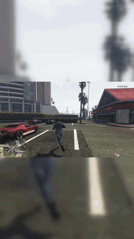

# gta-clipper

- **What it does:** it finds the action in a GTA V gameplay recording (PS5 captures) and cuts it into vertical
  1080x1920 clips of 15-30 s for Shorts, automatically.
- **How I measured it:** before improving the tool, I built a way to score it: a list of where the action is (and where
  a clip must never go) in each video, and my own "would I post this?" rating of each clip.
- **What didn't help:** a local vision model, added to throw out bad clips. On two new videos, the setup I had chosen in
  advance made exactly the same clips as the tool without it (one other setup did worse). A simple code rule fixed the
  model's 3 mistakes on the videos I tuned on, but I wrote it after seeing those mistakes, and on the new videos it
  turned 2 of the model's right calls into wrong ones.
- **Final result:** on the two new videos, 5 of the top 10 clips were ones I would post (one video gave only 4 clips,
  and the empty slot counts as a miss). On the two videos the tool was tuned on: 8 of 10.

<!-- Demo video: the MP4 is uploaded with GitHub's web editor; its link goes on the line below this comment. -->
https://github.com/user-attachments/assets/4c7f8082-6576-4eb1-9233-058405f441fa




*Output on test1 with `--spread v9`, the default before v10: clip 4 of 5, 2:16.0-2:46.0 of the source, rated postable. The GIF shows 6 s
of it (2:32.0-2:38.0, around the clip's peak at 2:35.0).*

## Result

| Postable@5 (out of 10) | Dev: test1 + test2 | Held-out: heldout1 + heldout2 |
|---|---|---|
| `--vlm off` (no vision model) | 8 | 5 |
| The frozen vision-model config (4b v3 + star rule) | 8 | 5 |
| 4b + stars, the only config worse than off on held-out | 8 | 4 |

Postable@5 is how many of the first 5 clips per video I rated postable ([How I measured](#how-i-measured)).

- **The vision-model step added nothing on held-out.** The frozen config made exactly the clips that `--vlm off` made,
  on both held-out videos (same rank, start, end and peak). It costs 69.4 s of model time (its 4b v3 answers) and
  15.0 s of contact sheets over the two videos, and changed no clip. Of the six vision-model configs, five equal off and
  one did worse (4b + stars, 4 of 10).
- **Dev is in-sample.** The rules were tuned on test1 and test2, and every config scored 8 of 10 there, so dev
  Postable@5 can't tell the configs apart.
- **Held-out 5 of 10 includes an empty slot.** heldout2 made only 4 clips, and the missing 5th counts as not postable:
  5 postable of 9 clips made.
- **This is weak evidence.** 14 rated held-out clips from 2 videos, and heldout2 has only about 22.5 s of action. Why
  held-out scored lower than dev was not tested.

Details: [eval/BASELINE.md, v8](eval/BASELINE.md#v8-the-one-time-held-out-test-2026-10-24).

## How I measured

Four GTA V recordings: test1 (15:24.7) and test2 (20:49.7) are the dev set, and the rules were tuned on them.
heldout1 (15:18.7) and heldout2 (5:59.0) were used once, for the held-out test.

- **Answer keys** (`eval/answer_keys/`, one per video): `action` ranges (shootouts, chases, crashes, carjacks, driving
  with wanted stars) and `never_pick` ranges (pause maps, cutscenes, phone calls, shop menus). `eval.py` scores a run
  against them: strict hits (at least 50 % of a clip inside action ranges), recall, and bad picks (clips that touch a
  never-pick range).
  - test1 and test2: drafted from contact sheets (one frame every 10 s, with pause-map, phone-call and cutscene edges
    checked on finer sheets), confirmed by me on 2026-10-22, then revised twice from 0.5 s frames. Each key lists its
    revisions and their frame evidence.
  - heldout1 and heldout2: drafted by Claude from video frames (10 s, 2.5 s, and 0.5 s at every edge). I answered five
    policy questions and accepted the ranges, but did not check them frame by frame.
- **Postable@5**, from my ratings: of the first 5 clips per video, how many I rated postable, out of 5. An unrated clip
  counts as not postable. Each rating is postable or not, with a reason.
  - I rated the 14 held-out clips blind, on a page with no scores, ranks, configs or model verdicts
    (`make_rating_page.py`), before any vision-model run.
  - I rated the dev clips on the review sheet, which shows scores and ranks, so those ratings are not blind.
- **The vision model as a judge**, on every candidate clip I rated: a *costly veto* is a clip I rated postable that the
  model threw out; *kept but not postable* is a clip I rejected that the model let through.
- **A pre-registered, one-time held-out test.** The plan, including the rule that picks the final config from dev
  results, was written before the held-out videos were opened ([eval/HELDOUT_PLAN.md](eval/HELDOUT_PLAN.md)). The config
  was frozen in commit `6e0a9f3`, and then each config ran once per video. Nothing in the code, prompts, thresholds or
  keys changed after a held-out clip was seen. The deviations from the plan are listed in
  [BASELINE v8](eval/BASELINE.md#deviations-from-the-plan).
- Since that test, heldout1 and heldout2 count as dev data; a new claim needs new footage.

Details: [the Postable@5 rules (PR 5)](eval/BASELINE.md#pr-5-eval-fixes-and-postable5-2026-10-23),
[keys and blind ratings](eval/BASELINE.md#keys-and-blind-ratings).

## What worked

- **Reading the HUD (v2, v3).** The tool takes small crops of GTA V's on-screen HUD. No minimap for 1.5 s or more means
  a pause map, cutscene or menu, and no clip may touch it; wanted stars add to the score; the phone's call screen is cut
  out. On dev, bad picks went from 4 in v1 (two phone calls, a pause map, a cutscene) to 1 in v2 and 0 in v3.
  - On held-out all 16 runs had 0 bad picks, against keys I didn't check frame by frame. Two of heldout1's never-pick
    stretches (the walk inside the Ammu-Nation shop and the Mission passed overlay) show the minimap, so the HUD rules
    didn't exclude them; no clip went there.
  - The cost: the phone rule removed a crash I had rated postable (test2 19:07.5, the car hits a lamp post while the
    phone's call screen is still up). That stretch has had no clip since v3.
- **Cutting each clip to the action (v4), with a 15 s minimum.** A clip runs from 1.0 s before the action to 1.5 s after
  it, 15-30 s long. I set the 15 s minimum after rating 8 s clips, two of which were "too short". On dev, Postable@5
  went from 7 to 8 of 10 (test1 4/5 to 5/5; test2 3/5 both times), and test1's recall from 4/5 to 5/5.
  - The +1 is one clip. v3 cut the moment around 2:35.0 as 2:26.0-2:46.0, which I rated "boring, bad cut"; v4 cut it as
    2:16.0-2:46.0, which I rated postable. That is the demo clip above. Dev only, and not blind.
- **GPU decoding (v3).** Decoding on the GPU (NVDEC) cut a whole run from 232.20 s to 81.24 s on test1 and from
  297.20 s to 87.34 s on test2. `timeline.csv` was byte-identical to the CPU run's on both videos.
- **Spreading the clips across the video (v10), a trade-off.** A short stretch with no minimap no longer ends an action sequence, so
  a chase can't use one to get past the limit of 2 clips per sequence. On a 25:04 recording the clips went from one
  5-minute block to four. Postable@5 is unchanged on all 6 recordings (the 4 above and 2 with no answer key). test1's
  strict hits and recall both fell from 5/5 to 4/5. I made it the default because I rated 2 of the 3 clips it adds on
  the 25:04 recording postable.

Details: [v1](eval/BASELINE.md#v1-baseline-2026-10-22),
[v2](eval/BASELINE.md#v2-hud-aware-scoring-compared-with-the-baseline-2026-10-22),
[v3](eval/BASELINE.md#v3-strict-eval-owner-ratings-spread-phone-gpu-decoding-compared-2026-10-22),
[the lamp-post crash](eval/BASELINE.md#the-lamp-post-crash-test2-19075-19095),
[v4 at 15 s](eval/BASELINE.md#v4-with-a-15-s-minimum-2026-10-23),
[v3 and v4 rescored (PR 5)](eval/BASELINE.md#results-dev-set),
[v10](eval/BASELINE.md#v10-spreading-picks-across-the-video-2026-11-04).

## What failed

The idea: before a candidate becomes a clip, a local vision model (Qwen3-VL 4B or 8B Instruct, through Ollama) looks at
8 frames of it and may veto it as boring, a clumsy crash or a menu. It is off by default (`--vlm`).

- **The veto itself (PR 6).** On the 12 rated dev candidates, with the final prompt (v3), the 4b vetoed 3 clips I rated
  postable. All three had at least 27.5 s of measured wanted stars, and it called them boring (one is the demo clip).
  The 8b vetoed no rated clip, so it also kept both clumsy crashes I rejected. Postable@5 didn't change with either
  model. None of the three prompt versions allowed met the stopping rule (neither model vetoing a clip I rated
  postable). Model time per video: 45.0-46.6 s for the 4b, 64.0-66.4 s for the 8b.
- **Telling the model the wanted stars as text (PR 7).** The tool already measures the stars, so the prompt got a line
  such as "Measured by the tool: wanted stars visible for 27.5 of 30.0 s." The 4b still called clips with 27.5-30 s of
  measured stars boring. With the final hint prompt it made 4 costly vetoes and kept 2 rejected clips (3 and 0 without
  the hint); the first hint prompt made it veto all 10 test2 candidates, 3 of them postable.
  - A code rule instead (cancel a "boring" veto when the clip has 5.0 s or more of stars) made no mistake on the 12 dev
    candidates. But it was written after the 4b's three dev mistakes were known, so that result is in-sample.
- **The held-out test (PR 8).** The frozen config was the 4b with that star rule. On held-out it made 2 costly vetoes
  (dev: 0) and kept 4 of the 5 clips I rejected (dev: 0 of 2).
  - The star rule changed 2 verdicts, both from agreeing with me to disagreeing: it kept two police chases I had
    rejected ("crashing a lot"; the other with no reason given).
  - No vision-model config had 0 costly vetoes on held-out. 10 of the 11 costly vetoes over all configs were plain
    drives with no wanted stars that I rated postable.
  - One of my rejections was "repetitive", a judgement about the whole set of clips that a veto of one clip at a time
    can't make.

Details: [v6](eval/BASELINE.md#v6-local-vision-model-veto-2026-10-24),
[v7](eval/BASELINE.md#v7-measured-wanted-stars-for-the-veto-2026-10-24),
[v8, every candidate and verdict](eval/BASELINE.md#table-c-every-candidate-and-every-verdict),
[every prompt version](prompts/LOG.md).

## Next

GTA 6 HUD support, once there is GTA 6 footage. The HUD rules only know GTA V's PS5 layout; GTA 6 will need new crop
boxes and new detectors.

## How it was built

Built with Claude Code. I (Udit) designed the evals, rated every clip, and made the decisions at each step.

## How to run

Tested on Windows 11 with Python 3.14.7 and ffmpeg/ffprobe on PATH (the Gyan "full" build 9.0). Standard library only,
so there is nothing to pip install. An NVIDIA GPU is used for decoding and encoding when it works, but isn't required.
Ollama is needed only for `--vlm`.

```powershell
python -m venv .venv
.\.venv\Scripts\python.exe clip.py C:\path\to\recording.mp4       # 5 clips, 15-30 s each
.\.venv\Scripts\python.exe clip.py --burn-hooks "<run folder>"    # after typing hooks in its hooks.txt: writes clip_NN_final.mp4
.\.venv\Scripts\python.exe eval.py C:\AI\gta\output\test1\<run>   # score a run against its answer key
.\.venv\Scripts\python.exe selftest.py                            # builds a synthetic video and checks the clips
```

`--burn-hooks` also takes `--hook-style box|shadow|outline` (default `box`) and `--hook-duration SECONDS|full` (default 3).
For a cold open and a punch-in zoom on a clip, type a peak after its hook, in seconds from the start of that clip:
`hook: Don't do this | peak: 14.2`. No peak means neither. `--no-cold-open` and `--no-zoom` turn them off.

Each run writes its clips, `scores.json` and `timeline.csv` to `C:\AI\gta\output\<video>\<YYYYMMDD-HHMMSS>\` (`--out`
changes the root). The test videos are not in the repo. Every flag, the output files, the HUD rules, the vision-model
stage and the known limits are in [docs/DETAILS.md](docs/DETAILS.md); every result is in
[eval/BASELINE.md](eval/BASELINE.md).

## Explainer Shorts

`explainer.py` is a separate tool that turns a script file into a finished 1080x1920 Short: a Kokoro voice, captions that
light up each word as it is said, a music bed that ducks under the voice, sound effects, fast cuts over your screenshots,
clips and text cards, and an ending that loops. It needs a few packages, which
go in their own `.venv-tts` on Python 3.13, because kokoro-onnx 0.6 (the release with word timing) doesn't allow 3.14.
`clip.py` stays standard-library only.

Install once:

```powershell
py -V:Astral/CPython3.13.15 -m venv .venv-tts
.\.venv-tts\Scripts\python.exe -m pip install -r requirements-explainer.txt
New-Item -ItemType Directory -Force C:\AI\gta\models\kokoro
$base = "https://github.com/thewh1teagle/kokoro-onnx/releases/download/model-files-v1.1"
curl.exe -L -o C:\AI\gta\models\kokoro\kokoro-v1.0.onnx "$base/kokoro-v1.0.onnx"
curl.exe -L -o C:\AI\gta\models\kokoro\voices-v1.0.bin "$base/voices-v1.0.bin"
```

Take the model from the `model-files-v1.1` release: the older release has a file with the same name and no timing, and
`explainer.py` stops if it finds that one. SHA-256 of the two files:
`beb0d1848dee9a49da392cc3df26958d46cfa35d321edf434f52949153f0df3a` (model) and
`bca610b8308e8d99f32e6fe4197e7ec01679264efed0cac9140fe9c29f1fbf7d` (voices).

Render:

```powershell
.\.venv-tts\Scripts\python.exe explainer.py examples\nov10_preload.json
```

That writes `short.mp4`, `voice.wav` (the voice alone), `captions.ass` and `log.json` to
`C:\AI\gta\explainers\<slug>\<YYYYMMDD-HHMMSS>\`, and prints the runtime, the shots, the music and sound effects used and
the final loudness.
`.\.venv-tts\Scripts\python.exe explainertest.py` checks the tool (88 checks, 2.8 min through `run_tests.py`; 23 min with
an ffmpeg that is slow to start, see [Tests](#tests-pr-31-nov-23)). `examples\explainer_sample.json` is
the longer PR 14 demo, in the short string form.

A script is a JSON file, and paths are relative to `C:\AI\gta\`:

```json
{
  "title": "GTA 6 pre-load is live",
  "voice": "am_puck", "speed": 1.0,
  "open_card": null,
  "music": "auto", "music_volume": 1.0, "sfx": true,
  "lines": [
    {"say": "GTA 6 pre-loads today, and you need 212 gigabytes free.",
     "visuals": [
       {"file": "rockstar/GTAVI_Screenshots/People/Jason and Lucia/Jason_and_Lucia_01.jpg", "focus": [0.36, 0.4]},
       {"card": "212 GB"},
       {"file": "rockstar/GTAVI_Screenshots/Places/Vice City/Vice_City_27.jpg", "pan": "right", "weight": 2},
       {"file": "rockstar/GTAVI_Videos/Jason_Duval_Video_Clip.mp4", "at": "0.3", "focus": 0.7}],
     "green": ["212 GIGABYTES"], "red": []}
  ]
}
```

- **Length.** The target is 34-39 s since PR 18 (it was 40-50 s), which is about 95-105 words at speed 1.1. Outside
  it warns, and so does a speed above 1.1: to fit the time, cut words rather than rush the voice. The
  [pacing check](#beat-types) prints after every render. A shot that stays up over 2.5 s warns (a pan may stay 3.5 s, because it keeps moving).
- **Shots.** A line's shots share its time by `weight`, 1 each unless set, so a shot with weight 2 stays twice as long as
  its neighbours. Each shot is an object with `file` or `card`:
  - `focus` is where the subject is across the picture: `"left"`, `"center"`, `"right"` or 0 (left edge) to 1 (right
    edge). The vertical crop centres on it as far as the picture allows, and the slow zoom heads for it. `[across, down]`
    also says how far down it is (`"top"`, `"middle"`, `"bottom"` or 0-1), so a zoom keeps a face that sits near the top
    of the picture. Without a focus the crop is centred. It works on videos too.
  - `"pan": "right"` slides the view across the whole width of a wide picture during the shot, from the left edge to
    the right edge (`"left"` goes the other way), at full height and a steady speed. It suits wide city and landscape
    shots, and needs a big enough share to stay smooth: over 1.2 screen widths a second warns.
  - `at` is where a video starts (`"0:16"`). A video's own audio is always dropped.
  - Images with no pan get a varied slow zoom or drift. Where a shot sits on screen (in a card or full screen) is in
    [Explainer style](#explainer-style).
- **Cards.** `{"card": "~NOV 12~|*NOV 10*"}`: `|` starts a new line (3 at most), `~words~` get a red bar struck through
  them a moment after the card appears, and `*words*` are cyan (the field is still called green).
- **The short form** still works: `"rockstar/x.mp4@0:42"` (a video from 0:42), `"rockstar/x.jpg@0.3"` (an image with focus
  0.3) and `"card:SOME TEXT"`.
- A clip too short for its slot loops only if its last and first frames nearly match, and otherwise holds its last frame.
  Rockstar's character clips last 1-1.5 s and all hold, so give them short slots.
- `green` and `red` list words or phrases from that line's `say`, which must match or the render stops.
- **Captions** follow Kokoro's own sound durations. By default each word shows alone as it is said (see
  [Explainer style](#explainer-style)); `"caption_style": "phrase"` shows 2-4 words at a time with the spoken one yellow,
  as in PR 16. Words in `green` (drawn cyan) and `red` keep their colour. Captions stay inside Shorts' safe area, and none
  shows while a text card is up.
- **Voice.** `voice` is any of Kokoro's English voices (`af_`, `am_`, `bf_`, `bm_`); the default is `am_puck`. A name
  that doesn't exist stops the run and lists them.
- **Music.** `music` is a file name in `C:\AI\gta\music\` (or a path under `C:\AI\gta\`), `"auto"` to pick one from
  that folder, or `null` for none (the default). `"auto"` picks the same track every time for the same title and prefers
  one long enough not to loop; with an empty folder it warns and renders without music. The music fades in over 0.5 s,
  fades out over the last 1 s, and sits 16 LU under the voice while it speaks, rising 4 dB in pauses of 0.3 s or more
  (Kokoro's sentence breaks are shorter, so mostly it stays down). `music_volume` scales it: 1 is normal, 0.5 is 6 dB
  quieter, 2 (the most) is 6 dB louder.
- **Sound effects** are made by the tool, no downloaded files: a soft whoosh when a line starts or a pan begins, and a
  hit when a card appears (a hit wins if both land together). Never on every cut, never on the first frame. A whoosh is
  about 13 LU under the voice, a hit about 8. `"sfx": false` turns them off.
- The final mix (voice, music, effects) is brought to -14 LUFS with peaks under -1 dB, and both are printed.
- Numbers are safe to write as digits, but write "70 dollars", not "$70", which is read as "dollar seventy".
- A missing file, a bad time, a bad shot setting or a tag that isn't in the line stops the run before anything renders.
  `log.json` records the durations, every shot with its focus, pan speed and weight, the visual on screen each second,
  and any warnings.

### Explainer style

The default look since PR 17 is "look C". I picked it from three style samples (A, B and C, made from Rockstar's
media) and approved its second version, C2.

- **Framed pictures.** A landscape picture or clip sits in a square card with a white border and a hard shadow, cut
  around the shot's `focus`, over a blurred, darkened copy of itself. A portrait picture fills the screen. Set
  `"layout": "framed"` or `"full"` on a shot, or for the whole script; `"card_aspect"` is `"1:1"` (the default), `"4:5"`
  or `"16:9"`.
- **Word captions.** One word at a time in Lilita One, yellow with a thick black outline, over the lower part of the card.
- **Text cards.** A number at the start of a card counts up from 0 in 0.6 s (`{"card": "212 GB"}`), and a `~struck~`
  line gets a red bar drawn left to right. Behind a card is the next picture, blurred (`"bg"` picks another).
- **Labels and marks.** `"label": "PS5 | 12 AM local"` puts a pill on the card's edge; the long form is
  `{"text": ..., "style": "info" | "no" | "number", "pos": "top" | "bottom"}` (cyan, red, pink). `"marks"` pins an icon
  to a spot on the picture: `[{"icon": "x", "x": 0.74, "y": 0.3, "at": 0.4}]`, with `x`, `check`, `arrow` or `circle`.
- **Grade.** A little more contrast and colour, and a soft vignette. `"grade": false` at the top of the script turns it
  off.
- **Loop.** The last frame's picture is the first frame's again (the last spoken word's caption can still be up). When
  the Short opens on a clip used from its start, the ending plays that clip backwards into its first frame, so nothing
  stands still (before PR 18 it held that frame for 1.5 s). The ending takes the last 1.5 s, and it never takes a
  picture's whole time: a shot it would cover starts earlier and gets at least 1.0 s, taken from the shot before it
  (before PR 19 a last line shorter than 1.5 s lost its picture).

```powershell
.\.venv-tts\Scripts\python.exe explainer.py examples\nov10_preload_v2.json   # the Nov 10 Short in look C
.\.venv-tts\Scripts\python.exe explainer.py examples\look_c_videos.json      # Rockstar clips framed and full screen
```

### Beat types

Since PR 18 a shot can pick a beat type with `"beat"`, so a Short mixes full-screen shots and cards. A line may call
its shots `"beats"` instead of `"visuals"`. Shots without a beat are drawn as before.

- `full`: a picture or video on the whole screen, zooming slowly at its `focus`.
- `lockon`: full screen; a red box drops onto `box` (`[x, y, width, height]` in the picture's own pixels) with a short
  `label`, the camera zooms at it, and a click plays as it lands.
- `card`: the square framed card from look C (or a text card, with `"card"`).
- `compare`: two stacked cards, `top` and `bottom`, each with a `label` (grey above, pink below). The second slides in
  0.8 s after the first, with a low whoosh and then a higher one.
- `snippet`: a white card of plain text, 18 words at most, with a yellow marker sweeping across the `highlight` words.
  It is plain text on purpose and never copies the look of a website or an article.
- `count`: a text card whose number counts up (`"card": "212 GB"`).
- `banner`: a pill of 1-3 words (`"text"`) over full-screen footage for 1.5 s.

```json
{"say": "But here's the catch. The map is bigger than one city.",
 "beats": [
   {"beat": "banner", "text": "The catch", "file": "rockstar/a.jpg"},
   {"beat": "lockon", "file": "rockstar/b.jpg", "box": [1805, 778, 615, 475], "label": "Look here"},
   {"beat": "compare", "top": {"file": "rockstar/c.jpg", "label": "Vice City"},
                       "bottom": {"file": "rockstar/d.mp4", "at": "0:03", "label": "Leonida Keys"}},
   {"beat": "snippet", "text": "Unlocks at midnight on November 19.", "highlight": ["midnight"]}]}
```

- **Video.** Any beat takes a video (`.mp4`, `.webm`) with `at` for its start, also as a text card's `bg`. PS5 VP9
  recordings get the same limited-range fix as `clip.py`.
- **Subscribe pill.** `"end_pill": "@NeonGetaway • Subscribe"` at the top of the script shows a small white pill for the
  last 2 s, with a cursor click and a click sound. Nothing is spoken, and it is gone before the last frame.
- **Safe area.** A lock-on region too near the picture's top or bottom can't be brought into the safe area, and the
  render stops and says so. While a compare is up, the word captions sit between its two cards.
- **Pacing check.** After a render the tool prints the length, the number of visual changes, the changes every 10 s and
  the longest gap. It warns (it never fails) outside 34-39 s, under 4 or over 6 changes every 10 s, or with a gap over
  3 s. A change is a cut, a compare's second card, a mark or the pill; things within 0.5 s of a cut count with it.

```powershell
.\.venv-tts\Scripts\python.exe explainer.py examples\beats_demo.json                  # every beat type, 35 s
.\.venv-tts\Scripts\python.exe explainer.py examples\beats_video_test_TEST_ONLY.json  # GTA 5 footage; test only
.\.venv-tts\Scripts\python.exe explainer.py --pacing C:\AI\gta\explainers\<slug>\<run>   # the pacing check again
```

What the checks caught: text must stay inside x 60-960, y 380-1540, clear of YouTube's buttons on the right and its title
and bar at the bottom. `explainertest.py` measures this on real pixels, and on the way it found three ways text got out.
Very wide text was too big for the canvas the tool measures text on, so it was measured too small and drawn 1050 px
wide. Text grows to 106 % for a moment as it pops in. And a count-up passes wider numbers than its final one ("204" is
wider than "212"). Cards are now sized for all three.

Fonts: [Anton](fonts/OFL.txt) and [Lilita One](fonts/LilitaOne-OFL.txt), both SIL Open Font License. Kokoro's weights are
Apache-2.0. `phonemizer` and eSpeak NG, which it installs, are GPL-3.0.

## Topic to Short

Since PR 19 a topic becomes a finished Short with its upload text, and my job is only to review it. In Claude Code:

```
/new-short GTA 6 pre-load is live since Nov 10
/batch-shorts GTA 6 pre-load is live since Nov 10; the 6 regions of Leonida; what time GTA 6 unlocks
```

Claude scores the topic (1-5: does it matter to almost every player on day one?), writes the script from `facts.json`
only, picks the pictures, renders, looks at the picks, and reports the paths. Nothing is ever uploaded. The same thing
by hand, in Windows PowerShell:

```powershell
.\.venv\Scripts\python.exe tag_media.py                                  # once, and after adding pictures (needs Ollama)
.\.venv-tts\Scripts\python.exe make_short.py C:\path\to\script.json --check   # checks only, renders nothing
.\.venv-tts\Scripts\python.exe make_short.py C:\path\to\script.json           # checks, picks, renders
.\.venv-tts\Scripts\python.exe make_short.py C:\path\to\script.json --allow-stale              # render even with a fact checked over 3 days ago
.\.venv-tts\Scripts\python.exe make_short.py C:\path\to\script.json --folder-date 2026-11-11   # render that day's folder again
.\.venv\Scripts\python.exe shorttest.py                                  # 42 checks, 10 s, no Ollama needed
```

Each Short gets a folder, `C:\AI\gta\shorts\<date>-<slug>\`:

| File | What it is for |
|---|---|
| `short.mp4` | The Short. |
| `upload.txt` | The title, and the description with its 3-5 hashtags. |
| `claims.txt` | Every line next to the facts it uses, their status and their source links. |
| `picks.jpg` | Each picture (the part the viewer sees) next to the words said and shown over it, and its seconds on screen. A picture that never gets on screen is grey, and the Short is NOT READY. |
| `pacing.txt` | The pacing check. |
| `script.json`, `script_resolved.json` | The script as written, and as rendered (every query now a file). |

The last line `make_short.py` prints is `READY` (34-39 s long and no pacing warning) or `NOT READY` and why.

### The facts file

`facts.json` is the only source of claims. Each fact has an id, the plain claim, a safe wording, a status, a source
link (and `more_sources` for other links that say the same), the day it was checked (`checked_on`) and whether it
can change from day to day (`time_sensitive`). Only I change a status; Claude adds new facts as `unverified`.

| Status | In a script |
|---|---|
| `confirmed` | May be stated. |
| `reported` | Only in its safe wording, which says it is a report: "on Xbox, pre-load reportedly opened at midnight GMT". |
| `unverified` | Refused. |

Every line of a script lists its facts (`"facts": ["release-date"]`, or `[]` for a line like "Let me explain."). The
check refuses a missing list, an unknown or unverified fact, a reported fact without its safe wording in that line, and
any number said or shown that is not in the wording of a fact that line lists. It can't read meaning, so a wrong claim
with no number in it still passes under a real fact ID: that is what `claims.txt` is for.

**Stale facts.** Launch-week facts change: Rockstar moved digital pre-load from November 12 to November 10 on
November 3, and a Short made from the old date had to be thrown away. So a script that uses a `time_sensitive` fact
whose `checked_on` is more than 3 days old is refused, by `--check` too, with a list of those facts:

```
ERROR: the script needs fixing before it can be made:
  2 facts in this script can change from day to day and were last checked more than 3 days ago, so nothing was rendered (today is 2026-11-16):
    - "GTA 6 launches 19 Nov 2026 on PS5 and Xbox Series X|S."  (release-date, lines 2, 7): last checked on 2026-11-12, 4 days ago
    - "Pre-loading does not let you play early."  (preload-no-early-play, line 6): last checked on 2026-11-12, 4 days ago
  Read each one again against its source link. If it still holds, set its "checked_on" in facts.json to today's date; if it changed, fix the fact first. To render anyway, add --allow-stale.
```

`--allow-stale` renders anyway and turns the list into a warning. It is for me; Claude never passes it.

### Pictures by what they show

`tag_media.py` has a local vision model look at Rockstar's 334 pictures and 9 video loops and saves, for each one, a
description, the main subject, the things in view, the setting, a focus point, its type (screenshot, wallpaper,
edition, key art, video loop), its shape, and whether big text, a logo or an age-rating card is printed on it. The tags
are in `C:\AI\gta\rockstar\_tags.json`. `_tag_check\index.html` in that folder shows every thumbnail with its tags; fixes
made there are saved as `_tags_override.json`, which always wins over the model.

A shot then asks for a picture instead of naming a file (a file path still works):

```json
{"beat": "full", "query": "swamp airboat", "region": "Grassrivers"}
{"beat": "card", "query": "bridge ocean", "label": "Leonida Keys"}
{"beat": "full", "query": "game logo", "media": "video", "text_ok": true}
```

- A picture is never used twice in a Short (the six cuts of one wallpaper are one picture), and pictures of the last 5
  Shorts are avoided while another good match exists (`C:\AI\gta\shorts\_used_media.json`).
- A full-screen shot prefers a phone-shaped picture, a card a square one and a compare a landscape one.
- A picture with big text or a logo needs `"text_ok": true`. One with a rating card is never picked. A video needs
  `"media": "video"` and starts after its rating card. A picture of a paid edition's bonus items needs
  `"type": "edition"`.
- If nothing matches well, the Short stops and names the closest picture. `--allow-weak` uses it and marks it red on
  `picks.jpg`.
- A label that names a region picks from that region's folder, a picture of the place before one that is mainly of a
  person, and is refused on a picture from anywhere else or on one whose subjects clearly contradict it
  (`regions.json`). The folder is trusted over the "where" tags, which are the model's weakest.
- `lockon` and `marks` point at a spot in one picture, so those shots name a `file`.

The three demo scripts are in `examples\shorts\`. The 34-39 s target is checked on the real voice: short, choppy lines
are read faster, so a script of place names needed speed 1.0 and 111 words where the others fit at 1.1 with 100-105.

**Which model.** `qwen3-vl:8b-instruct`, compared with the 4b on 20 files that I judged by eye against notes written
before reading the answers. The tags were equally good (98 of 100 checks each). The 8b put the focus point within a
tenth of the frame of the subject on 14 files against 8, and the 4b answered the exact centre 8 times. The 8b takes
about 7 s a picture against 4.5 s. The plain `qwen3-vl:4b` and `:8b` return nothing, because they spend the whole
answer thinking, so the `-instruct` builds are used. The check for text and logos got 12 of 14 sample files right; both
misses were big signs inside the scene called "big text", which only keeps a picture out.

### Title rules

32-46 characters, ALL CAPS on only 1 or 2 words (GTA, PS5 and other always-capital names don't count), no hashtags, and
it may end with `...` or `!?`. Like the hook, it must be literally true. The script rules (a true, surprising first
line, then "let me explain", proof by second 3, a twist, a payoff, a last line that loops) are in
`.claude/commands/new-short.md`.

## Footage library

Made for GTA 6 launch week (PR 21): the tool watches my own recordings and logs what happens in each part, so a Short
about "police chases" can ask the library for chase footage instead of me scrubbing through hours of video. There is
no GTA 6 footage yet, so everything here was built and measured on GTA V and takes a HUD profile (`--profile gta5`
now, `gta6` once calibrated).

```powershell
.\.venv\Scripts\python.exe index.py C:\AI\gta\input\test1.webm --profile gta5   # index one recording
.\.venv\Scripts\python.exe index.py --all C:\AI\gta\input                       # every recording in a folder
.\.venv\Scripts\python.exe library.py find --activity chase --min-stars 2 --min-len 6
.\.venv\Scripts\python.exe library.py shotlist                                  # shot-list coverage table
.\.venv\Scripts\python.exe indexeval.py test1                                   # measure an index (dev videos only)
.\.venv\Scripts\python.exe indextest.py                                         # the tests (no Ollama, no footage)
```

`index.py` writes `C:\AI\gta\library\<video>\index.json` and `review.html` (one row per segment, never-use rows in
red, click a time to play it), and adds the recording to `C:\AI\gta\library\library.json`.

**How a recording is indexed.**

1. One ffmpeg pass (GPU decode) reads the HUD twice a second and saves one "sheet" per 6 s of video: 4 frames, 1.5 s
   apart, in a 2x2 grid.
2. Code reads the HUD first, with `clip.py`'s own detectors and the profile: minimap there or not, phone call screen,
   wanted stars. New: it also counts the stars (an earned star has a dark outline round a lighter middle; an empty
   slot is a flat grey shape). GTA 6 has no bars by its minimap, so there "minimap" means its player arrow, in either of
   the two looks the game draws it in: a white pointer in a dark disc or a dark pointer in a white disc (PR 36; knowing only
   the first one made 34 stretches of gameplay, 9.7 minutes, cutscenes: `docs/false-cutscenes-pr36.md`).
3. A local vision model (`qwen3-vl:4b-instruct` in Ollama) looks at each sheet and answers in strict JSON: `activity`
   (driving, on_foot, shootout, chase, flying, boat, swimming, cutscene, menu_map, phone, loading, other), `vehicle`,
   `police_visible`, one `notable` line, `confidence`. It is told nothing about the HUD.
4. Code merges both into segments. The HUD rules apply per half second and always win: call screen up = `phone`; no
   minimap for 1.5 s = `cutscene` (or the model's `menu_map`/`loading`); in a vehicle with wanted stars = `chase` (one
   frame can't show a chase, the stars can). `cutscene`, `menu_map`, `loading` and `phone` segments are `never_use`.

Every model answer is cached, so a re-run takes seconds and a stopped run carries on. Held-out footage
(`C:\AI\gta\heldout`) is refused. The answer keys are only read by `indexeval.py`, never by the indexer.

**Speed probe** (first 3 min of test1, seconds per model call once loaded):

| Model | s per call | Note |
|---|---|---|
| `qwen3-vl:4b` (plain) | 8.2 | unusable: it spends the answer thinking, 3 of 3 replies were cut off |
| `qwen3-vl:4b-instruct` | 3.4 | fits the 8 GB GPU whole (3.6 GB) |
| `qwen3-vl:8b-instruct` | 5.0 | 0.9 GB of it runs on the CPU |

The picture size made no difference (320, 448, 640 and 960 px wide all took 3.3 s with the 4b): Ollama turns every
picture into about 1,500 tokens. So a call costs the same for 4 frames as for 1, and the indexer sends a sheet of 4.
**The model therefore answers once per 6 s sheet, not once per frame**: 3.4 s per call, which is about 0.85 s per
frame it looks at. The 8b-instruct would need about 18 minutes per 20 minutes of video. On the sheets the 4b also
caught test1's 2:10 shootout, which the 8b called on_foot.

**Time per video** (each one's first run, nothing cached; all four dev recordings):

| Video | Length | Sheets | ffmpeg pass | Model | Total | Per 20 min of video | Model reloads |
|---|---|---|---|---|---|---|---|
| test1 | 15:24 | 155 | 45 s | 529 s | 590 s (9.8 min) | 12.8 min | 3 |
| test2 | 20:49 | 209 | 58 s | 703 s | 766 s (12.8 min) | 12.3 min | 0 |
| Grand Theft Auto V_20261026160754 | 8:05 | 81 | 23 s | 275 s | 302 s (5.0 min) | 12.4 min | 0 |
| Grand Theft Auto V_20261026163544 | 25:04 | 251 | 69 s | 846 s | 920 s (15.3 min) | 12.2 min | 0 |

The model took 3.37-3.41 s per sheet on every video, and all 696 sheets ended with a usable answer.

**Memory.** In the speed probe Ollama's memory grew as pictures were sent: free memory fell from about 12 GB to
4.4 GB over 60 calls. So `index.py` unloads the model when free memory drops under 5 GB, and the next call loads it
again (about 5 s). In the full runs only test1 needed that (3 reloads); test2 and the two October 26 recordings
finished with none. I don't know why test1 differed, so the guard stays.

Launch night (Nov 19) showed the guard was too late: a prepare was stopped from outside at about 3.8 GB free, under
the old 2 GB stop. Now (index and the safety checks alike) the model is unloaded under **7 GB** free (at most every 10
calls), under **5.5 GB** after any call, and the run stops cleanly under **4.5 GB** (`ERROR: ...`, exit 2; the answers
so far are cached and the same command carries on). The re-run of that night's prepare dropped from 11 to 7.4 GB free
in about a minute during the safety checks; the guard unloaded the model 4 times, the lowest was 6.8 GB, and it
finished in 25 minutes.

**One heavy job at a time** (`heavy.py`). `launch.py prepare` and `render`, `index.py`, `tag_media.py`,
`footage_short.py` and the suites that render (`launchtest`, `topictest`, `storytest`, `footagetest`,
`explainertest`) take one lock, `C:\AI\gta\_heavy_job.json`. A second one stops with `ERROR: another heavy job is
running: ...` naming the one that holds it; a lock whose process is gone is taken over. Each prints `Free memory: X GB`
when it starts; prepare also prints it before the index, before the safety checks and at the end.

**A stopped prepare carries on.** Its run stays "preparing" in `_launch_runs.json`; the next prepare reuses that folder,
the cached model answers and the clip.py runs that finished (`launch_clip_done.json` in each).

**Spoken swearing** (`speech.py`, .venv-tts only). After each render the finished Short is transcribed with
faster-whisper small.en (CPU, int8, about 4 s a Short; the 464 MB model is in `C:\AI\gta\models\whisper`). The
subtitle check's swear words said in the first 7 s fail the Short; later ones are a SWEARING flag; a Short with the
game's sound and none heard says so in its SOUND flag (listen once anyway: mumbled words can be missed). Without
faster-whisper the old "listen once" flag stays. The audio goes in through ffmpeg (faster-whisper's PyAV decoder
breaks with PyAV 19).


**Star count check.** `star_check.py` builds `C:\AI\gta\library\star_check.html`: frames the index says show a given
number of stars, each large, with the star corner zoomed and the index's count under it. On 18 frames (6 at 3 stars
and 6 at 4 stars from the two October 26 recordings, 3 at 1 star, and 3 at 2 stars from test1 because those
recordings have none) every count matched what the frame shows, flashing grey stars included. 5 stars has not come
up in any recording. The page was made with:

```powershell
.\.venv\Scripts\python.exe star_check.py "Grand Theft Auto V_20261026160754" "Grand Theft Auto V_20261026163544" --fallback test1 --want 3:6 4:6 1:3 2:3
```

**The shot-list.** `shotlist.json` lists launch-week mechanic topics (wanted system, police chase, driving, combat,
exploring, heist, stealing cars, crashes and stunts). Each topic is a list of shots written as library queries. It
holds only shots, no claims about GTA 6, and every topic is marked `verify after launch`.

**Measured on the dev videos** (`indexeval.py`; the prompt and rules were not changed after these numbers).

- test1, my five confirmed moments: 5 of 5 found. A moment counts as found when a usable segment there has the right
  activity (a vehicle activity for at least half of a driving range; a shootout segment for a gun moment), the stars
  were counted where I had stars, and a notable line names the thing where the moment is a thing (the body).
  - 0:50-1:10 gun out + carjack: shootout and on_foot, "gun drawn". The carjack is only described ("Player pushes
    car, then abandons it with a body on ground"), there is no carjack label.
  - 1:20-2:00 driving with stars: chase, 1 star, until the stars end at 1:52, then driving.
  - 2:10 shootout: shootout ("Player exits car, aims gun").
  - 2:50 body on the road: on_foot, "Body on ground after car crash with blood on pavement".
  - 3:10-4:10 driving with stars: chase, 2 stars, the whole range.
- never_use against the answer keys' never-pick ranges: test1 298 of 299 s (6 of 6 ranges), test2 518 of 558 s (9 of
  12 ranges at 95 % or more). The three low ones show the minimap, so the HUD rule can't see them and the model called
  them on_foot: walking while a call is on (10:38-11:02, 67 %), the clothes shop (17:15-18:35, 68 %) and the Lifeinvader
  entrance (20:05-20:35, 88 %).
- never_use outside the never-pick ranges: test1 12 s and test2 36 s, every one from the HUD rule (no minimap). The
  three I looked at are scripted cameras where the game itself hides the HUD: test2's house collapse (3:20-3:35, which
  my key calls action, so the best 15 s of that moment are never_use), the character-switch flash at 4:48, and a
  cinematic cut inside test1's yacht chase (11:10-11:15). The rest are a few seconds at the edges of cutscenes.
- A text search (`--text crash`) reads every sheet's line and gives the time of each match. The model sometimes
  writes what is missing ("no crashes or police"); since PR 23 a line that denies the word is skipped, and the row
  says how many it passed over.
- **A chase with no wanted stars is not found as a chase.** test1's yacht chase and test2's gang chase came out as
  `driving` (91 % and 95 %). The chase label comes almost entirely from the HUD rule (vehicle + stars); the model said
  chase on 2 of 364 sheets.
- A stretch with no minimap is called `cutscene` unless the model says menu or loading, so a short pause map can be
  listed as cutscene. It is never_use either way. So is GTA 6 gameplay where the game hides the minimap (binoculars, the
  focus view, a car's info panel, the safe house) and, not read yet, swimming under water, where the arrow's disc is grey.

## Footage Shorts (Mode B) and guided calibration

Made for GTA 6 launch night (PR 23). A **footage Short** is a 20-35 s Short built from my own gameplay, picked from
the footage library, with the same voice, captions, cards and music as the explainer Shorts. Rockstar's pictures
are only the fallback, and the GTA 6 lines still have to come from `facts.json`.

```powershell
.\.venv\Scripts\python.exe library.py find --stars-rise                          # every moment the wanted stars go up
.\.venv-tts\Scripts\python.exe footage_short.py C:\AI\gta\shorts\_drafts\<slug>.json --check   # check + pick, no render
.\.venv-tts\Scripts\python.exe footage_short.py C:\AI\gta\shorts\_drafts\<slug>.json           # render
.\.venv-tts\Scripts\python.exe footagetest.py                                    # the tests (no Ollama, no footage)
```

Or type `/footage-short <topic>` in Claude Code: it writes the script, checks it, renders and reports.

**The script** is a `make_short.py` script where a beat can ask for footage with `"shot"`: a `library.py` query
(`{"activity": ["chase"], "min_stars": 2}`, `{"stars_rise": true}`) or a shot-list id (`"police-chase/long-chase"`).
`"beat": "full"` fills the screen with the middle of the gameplay; `"beat": "card"` floats it as a framed card so the
minimap and stars stay in view. `"footage": {"profile": "gta5"}` keeps a GTA 5 Short to GTA 5 footage (and a GTA 6
one to `gta6`). To show an exact moment, a beat can name the recording itself: `{"beat": "full", "file":
"C:/AI/gta/input/test1.webm", "at": "223.1", "sound": true}`; that one is not checked against the index, so look at it.

**How footage is picked.** The voice is made once to learn each beat's length. Each shot beat takes the best piece
that this Short (and the last 5 Shorts) haven't shown: more action first, a star rise for a beat about stars. It is
cut on half seconds, never into a cutscene, menu, map, phone call or loading screen, and at least 1 s from a star
change at either end (a star-rise beat holds its own change, at least 0.5 s from each end in a beat under 2 s). The
footage behind a text card and the loop ending's lead-in must be clean too. After the render, every stretch that got
on screen is checked against the index again. The Short is READY at 20-39 s with all of it clean.

`<shorts>\<date>-<slug>\` gets `short.mp4`, `upload.txt`, `claims.txt`, `pacing.txt`, `picks.json` and `picks.html`
(one card per beat: a thumbnail, what the voice says over it, where it comes from and why, and "play this part").

**What the tool can't see, so check `picks.html` yourself:**
- burned-in game subtitles (mission dialogue can swear) and tutorial pop-ups. A full beat crops the corners away, a
  card beat keeps them;
- the car radio. Nothing measures music. The first footage Short (Nov 18, "My LAST ride in GTA 5") was checked with
  spectrograms, not by ear; a test mix showed a spectrogram catches music about as loud as the game sound but not
  8 dB quieter. Listen to the "play this part" links, or set `"game_audio": false`;
- whether a moment looks good. A crash beat is aimed at the middle of the index's 6 s window, which can miss the hit:
  pin it with `file` + `at`.

### Guided calibration (launch night)

One command makes a HUD profile for a game with no profile yet:

```powershell
.\.venv\Scripts\python.exe calibrate.py --guided --profile gta6 --video "C:\AI\gta\input\<first GTA 6 recording>.webm" --star-slots 6
```

1. It looks at about 120 frames of the recording (about 50 s for 8 minutes) and finds, with no GTA layout assumed,
   the coloured bars by the minimap and the wanted-star row.
2. A page opens with about a dozen pictures and the tool's guess for each (HUD shown or hidden, stars yes or no).
   Fix any wrong guess, check the bars and the star outline, press Save.
3. It tries the saved profile on 3 minutes of the recording with `index.py` (Ollama must be running; `--skip-index`
   leaves this for later) and prints PASS or FAIL, the pages to look at, and the next command when something is
   still to do. A recording with no wanted stars saves the minimap part and says STARS NOT CALIBRATED; run the same
   command on a clip with stars later. A finished profile is never overwritten.

**Tried on GTA V (PR 23)**, with a script standing in for me that accepted every guess, on `Grand Theft Auto
V_20261026160754` (8:05): 3 bars and a 5-slot star row, close to `gta5.json` (first star tip x 1695.9 vs 1696.5,
spacing 28.9 vs 28.6). That profile, on test1 and test2 (not used to make it), agrees with `gta5.json` on the minimap
in all but 20 of 1,850 and 3 of 2,500 half-seconds, and on the stars in all but 3 and 0. All 20 on test1 are inside
one cutscene with no HUD (5:16-7:06): in 18 `gta5.json` sees a minimap that isn't there, in 2 the new profile does. The first try found 5 bars: a map icon over a half-empty health bar had cut it
in pieces, and the minimap was missed in 6 % of test1. Fixed in `calibrate.find_strips`. On the other three
recordings it also found 3 bars; test2 (no wanted stars) ends with STARS NOT CALIBRATED as it should. A profile is
only as good as the bars it saw: in `Grand Theft Auto V_20261026163544` the special-ability bar was nearly empty, so
the tool kept only its 8 px lit end, and that profile misses test1's minimap in 44 of 1,850 half-seconds (2.4 %). On
launch night, calibrate on a recording where the bars are full. The phone is skipped in
guided mode, so phone calls are not cut out until it is calibrated by hand: in the check below, a 13 s phone call
that `gta5.json` marks never_use came out as usable on_foot.

**The whole command with the real Ollama check** (Nov 16; only the page was a stand-in accepting every guess) on
`Grand Theft Auto V_20261026160754`: RESULT: PASS in 3.2 min (scan 0.9, checks 2.3: 31 sheets, 0 errors, 3.7 s per
sheet; the memory guard unloaded and reloaded the model once). Minimap in 95 % of the 3 minutes, stars for 96 s, all
6 star-check pictures counted right (1 and 3 stars), and the segments match the library's own index of that stretch
(the same 1:54-3:34 chase at 3 stars) apart from the phone call. GPU peak 5.1 GB, 64 C. The browser page has not been
clicked through by a person yet.

## /launch: launch night's Shorts, made automatically (PR 25)

On launch night I record on the PS5, copy the files to `C:\AI\gta\input` and type `/launch` in Claude Code (Sonnet).
With no questions it finds the new recordings, reads the HUD (or works without it), finds the best moments, makes 3
Shorts and writes one review page. I watch, fix a hook or a cold open with one command if needed, and upload myself.
The steps for the night, including the recommended split night, are in [LAUNCH_NIGHT.md](LAUNCH_NIGHT.md).

```powershell
.\.venv\Scripts\python.exe launch.py prepare                          # new recordings -> candidates.json (the long part)
.\.venv-tts\Scripts\python.exe launch.py render                       # Claude's shorts.json -> Shorts + review.html
.\.venv-tts\Scripts\python.exe launch.py render --short 2 --hook 1    # use another of the 3 hooks
.\.venv-tts\Scripts\python.exe launch.py render --short 1 --no-cold-open
.\.venv\Scripts\python.exe launch.py prepare --dry-run --game gta5 --profile gta5_dry --videos <files>   # a trial
.\.venv-tts\Scripts\python.exe launchtest.py                          # 49 checks, half a minute, no Ollama
```

**What prepare does.**

1. Takes the recordings that are in neither the library nor an earlier /launch run, so a second run the same night
   takes only the new part, into `launch-<date>-part2`. Held-out footage is refused.
2. Uses `profiles/gta6.json` if it exists, else runs the guided calibration with every guess accepted
   (`calibrate_guided.auto_accept`).
3. Indexes every recording (index.py, a sheet every 6 s) and runs clip.py, unchanged, on each for its action score
   (loudness and picture change).
4. Checks the HUD against the vision model per recording; a HUD reading that can't be trusted means NO-HUD mode for it.
5. Scores every 30 s window of clean footage and keeps the best ones that don't overlap: action, star rises, stars
   showing, a chase or shootout, a crash, explosion or stunt the model saw, police, the model's confidence.
6. Picks the best moment in each third of the session that passes the safety checks and shows no footage an earlier
   Short showed, and gives it a type: an ACTION CLIP (game sound, music bed, burned-in hook, cold open and zoom at an
   AUTO PEAK taken from evidence only) or a NARRATED Short (am_puck over the moment's footage, playing on in real time).
7. Writes `candidates.json`: each pick with its evidence (E1, E2 ...: what the footage shows, when, and where that
   comes from), a frame sheet and, for an ACTION CLIP, strips of frames 0.2 s apart to pick the peak from.

Claude then writes `shorts.json` (3 hooks with its pick starred, title, 2-sentence description, hashtags, the peak or
the script, optionally a later start) and runs render, which checks everything, renders, keeps the sound under -1.0
dBTP, logs the footage as used and writes `review.html`: each Short's video, flags, hooks, script next to its evidence,
upload text and the commands to fix it.

**The truth rules (truth.py).** Every narrated line is either `on_screen`, citing evidence that is on screen while it
is spoken (measured on the real voice), or a `fact` from facts.json, as in /new-short. Code refuses a word without its
evidence ("stars" needs a HUD star reading, "crash" a crash), a number not in the evidence or a fact, a claim about how
the game works without a fact ("you can", "the game", "cops will"), any name but Jason and Lucia, and story words.
"GTA 6" and "GTA VI" are always fine. Hooks, titles and descriptions get the same checks.

**The safety checks (safety.py)**, measured on the dev recordings (answer keys as truth):

- A safety question to the vision model about every finalist, 4 frames a sheet, one a second: phone, menu or map,
  loading, cutscene, blood, subtitles. It caught the phone on 33 of 33 sheets of 5 real calls, including the call the
  guided profile left in, with no phone calibration at all. The second prompt (safety_v2, written after seeing the
  first one's mistakes) caught 23 of 31 cutscene sheets and 10 of 17 menu or map sheets of footage neither prompt was
  written from (the first: 8 and 8), and blocked none of 29 clean sheets there. Details in
  [prompts/LOG.md](prompts/LOG.md#safety-prompt-versions-pr-25-launch).
- No blood in the first 7 s: those seconds are asked twice a second, and the index's own lines count too. Blood there
  moves the start 7 s later once, or drops that type. The AUTO PEAK's cold open is checked again at render time.
- No swearing in the subtitles of the first 7 s: the model reads the subtitle band once a second (full size, 4 strips
  a sheet, `prompts/subtitles_v1.txt`) and code matches the words against a list of strong and moderate swear words
  and slurs (not damn or hell). It moves the start or drops the type like blood; swearing later is a PROFANITY flag.
  On the dry run's river chase it read every subtitle line word for word, "Fuck! Fuck!" at 4:12, "Watch your ass" at
  4:37 and "Shhiitttt!!" at 4:41 included (17 calls, 61 s for 68 s of footage). Spoken swearing in the game's sound
  is not checked: there is no speech-to-text, and every Short's SOUND flag says so.
- Never shown, anywhere in the footage (the owner, Nov 21): a child together with guns, shooting, a body or blood,
  or a body together with blood (`safety.never_shown`, from the index's own lines and the safety answers). The Nov 20
  dock shootout (gators shot at, a body on the dock, a child nearby, blood after 7 s) passed as a BLOOD flag and was
  picked twice; it drops now. Blood alone after the first 7 s is still a flag.
- Footage an earlier Short showed, pinned footage included (footage_short.py now logs it too), is never used again.
- Every render, here and in /new-short and /footage-short (explainer.py), is measured with ffmpeg's true-peak meter;
  over -1.0 dBTP, the sound alone goes through a limiter run at 192 kHz and is measured again, or the render fails.

**NO-HUD mode.** When the guided calibration fails, or the minimap is missing on more than half of the sheets the
model calls gameplay, or the star count flickers, a recording is indexed with a profile that sees no HUD: labels come
from the model alone, nothing mentions stars, and the safety question looks every half second. It is weaker: without
the HUD the index alone marks only 50 % (test1) and 26 % (test2) of the answer keys' never-pick seconds as never_use
(93-100 % with it), and finds 3 of test1's 5 moments (5 of 5 with it). The safety question is then the main guard.

**Faster index, measured and not used.** A sheet every 12 s took 341 s on test1 and 453 s on test2 (every 6 s: 590 s
and 766 s), but found only 3 of test1's 5 answer-key moments (every 6 s: 5 of 5), so /launch stays at 6 s.

**The dry run (Nov 17)** on the 4 GTA V recordings (69 min), with a fresh profile made by the guided calibration with
every guess accepted (PASS on the 25 min recording):

- The first prepare took 22.8 min: calibration 3.2, index 7.7 (the model's answers were cached, so only the HUD
  decode ran), safety checks 9.3 (159 model calls for 7 finalists; 4 failed: a phone, a cutscene twice, blood in the
  first 7 s). Its HUD check sent 2 of the 4 recordings to NO-HUD mode wrongly: the hand-made gta5.json fails the same
  0.8 threshold on them (0.72, 0.73), because the model calls about a quarter of story cutscenes gameplay. The
  threshold is now 0.5, and the second prepare (8.0 min, answers cached) kept all 4 in HUD mode.
- 3 Shorts, all READY after the render's own checks sent two scripts back once (lines spoken before their evidence was
  on screen: the voice says about 4 words a second, not the 2.6 first assumed): a NARRATED star rise in the rain
  (34.2 s), an ACTION CLIP of a gun-out run and a carjack (20.8 s, AUTO PEAK on the first star), and a NARRATED 4-star
  truck chase down the river channel (28.5 s, started 3.5 s later to skip a swear word in the mission subtitles). True
  peak -1.2 to -1.5 dBTP; the action clip measured -1.0 and was limited to -1.4.
- For 2 hours of footage: about 1 h 45 min (index about 77 min, safety about 10, calibration 3, renders and Claude's
  writing about 15). A 1-hour part of a split night: about 70 min.

**What it can't see, so check the review page:** burned-in mission subtitles (flagged, not read; the game's own sound
says the same words), music in the game sound, whether a crash looks cinematic, and whether a star-rise cold open is
exciting (it often isn't). GTA 6's HUD is unknown until launch night: if the calibration fails, the night runs in
NO-HUD mode.

## The story layer: Shorts that teach one thing (PR 26)

The /launch dry-run Shorts of PR 25 worked, but I couldn't post them: the gameplay was cut 7+ times every 10 s with
nothing on top, and the narration only described what happened. The S4 sample fixed the pacing, but a viewer still
couldn't follow it (a mission, a joke break, a circle that meant nothing). So a Short now has to **teach one thing**,
and my footage is the **proof**, not the content. The reference is a frame-by-frame breakdown of a top GTA 6 Shorts
channel (`docs/reference/`, not in the repo); the plan is [docs/S4_PLAN.md](docs/S4_PLAN.md).

**Edit engine v2 (`edit2.py`)**, used by /launch for every narrated Short (`--engine v1` keeps PR 25's):

- **One moment, in time order.** The background is cut from one stretch of one recording, into shots of 3.5-5.0 s
  cut where a word starts. Each shot starts at or after the end of the one before, so it may skip ahead but never
  goes back. The payoff gets one held shot (up to 6 s).
- **Words match the picture.** Every word that names something its line's evidence shows (stars, police, a crash, a
  thing the vision model saw) is on screen within 0.5 s of the word's start. The engine places the footage to make
  that true or names the word it can't.
- **Context first.** The first 2 s show the situation before the action.
- **A pop-in layer that explains**, 1.5-2 s apart (up to 3 s, every gap over 2 s logged with why), each with its own
  sound:
  - a rounded card of the HUD with the wanted stars ringed and zoomed;
  - a red ring that follows a car or a police car frame by frame (a template match; no ring if it's lost);
  - pills that name what's on screen;
  - F3's number badges.
- **The break** freezes on the key detail (ringed and labelled) or splits the screen, never with joke text.
- **The ending:** a silent subscribe pill and a loop back to the first frame. Yellow captions at Y 740 (picked from
  the sample).

```powershell
.\.venv-tts\Scripts\python.exe edit2.py examples\s4_sample.json --plan               # timeline, anchors, gaps
.\.venv-tts\Scripts\python.exe launch.py frame --short 1 --at 113.5                  # a gridded frame to read a box from
.\.venv-tts\Scripts\python.exe launch.py render --run "<run folder>" --engine v1     # PR 25's render
.\.venv-tts\Scripts\python.exe storytest.py                                          # 16 checks, 25 s
```

**The rules in code.**

- **truth.py:** every line either teaches (`on_screen` or `fact`, with `teaches`: what the viewer learns) or asks (a
  question with the line that answers it). It refuses:
  - play-by-play ("I drive ...", "So I cut across ...");
  - more or fewer than one payoff;
  - a last line without `loop` or ending in a full stop;
  - a spoken call to action;
  - an F2 line that says why without the change and the result cited in order;
  - a circle, HUD card, pill or freeze label that doesn't name what it shows;
  - mission footage without `mission_ok`.
- **launch.py (render):** the payoff must start at 45-75 % and a story Short must last 25-40 s.
- **launch.py (prepare): the quality gate.** A moment with nothing to teach and no payoff is skipped, and so is
  mission footage without a payoff that needs no story. /launch then makes 1-3 Shorts, not always 3.

**Formats** (each pick's `format_options` comes from its evidence; Claude picks one and says why):

| Format | What it teaches |
|---|---|
| **F1** GTA 5 vs GTA 6 | what changed |
| **F2** Test | the answer, on the HUD: the stars rise, then are all gone |
| **F3** Three things | 3 different things the moment shows |
| **F4** First look | the session's first boat, flight, swim, chase or shootout (GTA 6 only) |

For F1, the other side is my GTA 5 library clip of the same kind; a dry run uses Rockstar's official picture,
flagged DRYRUN STAND-IN, and render refuses that outside a dry run. LAUNCH_NIGHT.md and `shotlist.json`
(`experiments`) list 13 things to play on purpose for each format.

**The dry run (Nov 18)** on the 4 GTA V recordings:

- Prepare took 26.1 min (index answers cached).
- The gate skipped 3 mission moments, the S4 sample's river-truck chase among them.
- Of the 3 picks:
  - **Short 1 (F3, READY):** "Can you get three stars instantly?", a rainy night drive, police lights pulling up,
    then the HUD going from 0 to 3 stars, frozen and labelled. 28.6 s, payoff at 70 %, 9 pop-ins, background shots
    3.7 s on average, true peak -1.4 dBTP.
  - **Short 2 (action clip, READY):** a gun-out run, a star and a carjack, 20.0 s.
  - **Short 3 (left out):** a mission motorbike ride whose "crash" was really the bike riding into a tunnel. Nothing
    true to teach.
- The render's checks sent Short 1 back three times before it was right: a stunt word ("jumps"), two anchors on one
  instant, and the moment running out of footage. Each fix is in code or in launch.md.

**Not in this PR:**

- **Spoken swearing is still not checked.** faster-whisper is approved but not installed yet, so every Short's
  SOUND flag still says to listen once.
- **Action clips have none of the v2 extras** (slow-mo on the impact, a ring on the stars, a replay ending).
- **The split-screen break and a real F1 (GTA 6 vs my GTA 5 clip) haven't run on real footage.**
- **F4 can only run on GTA 6.**

## Launch fixes (Nov 19): every Short like the posted sample

On launch night /launch made 1 Short instead of 3, and it was raw gameplay. The causes, the fixes and the order I
asked for: the GTA 6 HUD (its own profile, `profiles/gta6.json`, calibrated on my footage: PASS), then **topics
first**, then **the story layer for every Short**, then labels and picking. The bar is the Step 0 sample I posted,
"How to make GTA 6 cops FORGET you": the hook on screen from frame 0, the am_puck voice with yellow captions, music
and sound effects, setup -> payoff, my footage as the proof.

**Engine v3 (the default render until Nov 20, now `--engine v3`; see Editor v3 below)** makes every Short that way, both types:

- Claude writes the lines and their **beats** (full screen, a framed card, a before/after compare, a banner), each at
  a second of the pick's own recording. A beat with `"zoom": "stars"` (or `"tip"`, `"minimap"`, or a box) is a
  close-up cut by `proof.py`: the star row with the heat icons under it, the game's tip box, the minimap. That is what
  made the sample readable on a phone.
- The starred hook is the opening card from frame 0; line 1 is the spoken hook. A silent subscribe pill and a loop
  end every Short.
- An **action Short** has a short voice too (3-5 lines, setup -> payoff) with the game's sound in. A Short with no
  lines is refused: no Short ships as raw gameplay.
- truth.py checks every line (evidence on screen while it is said, facts, numbers, names, no play-by-play), the words
  each beat puts on screen, one payoff at 45-85 %, a narrated Short of 25-39 s (action 16-32 s), and no beat on
  footage an earlier Short showed or that isn't clean in the index. `--engine v2` and `v1` keep the older renders.

**Topics first (prepare).** Topic candidates come first in the pool (+1.5 points): every `shotlist.json` shot the
night's footage matches, and on GTA 6 every change of the heat icons or of the stars' look, read by `proof.hud6` twice
a second. Each lists the facts.json ids its topic may use. A topic pick is NARRATED when its window fits, anchored on
the second its topic shows. Its evidence gains `heat` items (how many icons, and when they change) and `star_look`
items (solid red, red outline, hollow white, solid white), so a line may say "two icons are left" only when the HUD
shows it.

**Labels from the frames (safety_v3).** The safety question now also asks what the frames show: a crash, shooting,
police, an explosion, a jump, swimming or a boat. A candidate's crash, explosion, stunt, shootout or police points
stand only where those frames saw them (police also while the HUD shows stars); a "shootout" nobody shoots in is
relabelled on foot; a model line that names an event the frames didn't show can't support a word. Mission dialogue
(subtitles on 30 % or more of its sheets) costs up to 1.5 points. What was dropped is in each pick's
`dropped_labels`.

**The pool.** 15-25 candidates (5 per Short asked for), spread over every recording (60 s apart, each recording
its share), are all checked before picking; every one that fails is listed in `candidates.json` with why. The best
`--count` (default 3) that pass are picked.

```powershell
.\.venv\Scripts\python.exe launch.py prepare --count 3          # the default; --count 5 for more
.\.venv-tts\Scripts\python.exe launch.py render --run "<run folder>"
.\.venv\Scripts\python.exe facts.py own                        # facts from my own footage, waiting for my yes
.\.venv-tts\Scripts\python.exe topictest.py                     # 24 checks, 40 s
```

**Known limits:**

- Hollow white stars over a dark background are read as no stars (recording _022442 at 16:15): the calibrated star
  rule needs a lighter middle. Those seconds are "no stars", never a wrong number.
- Spoken swearing is still not checked (faster-whisper not installed yet): listen once to a Short with game sound.

## Editor v3 (Nov 20): payoff first, nothing twice, a steady picture

None of the 3 READY Shorts from launch night part 3 was postable. Short 3's crash was skipped, scenes repeated, the
picture wobbled, Short 2 opened on a blurry leaf and claimed six stars with no stars on screen, and the voice was slow
and described instead of talking to the viewer. **Engine v4** (the default render now) plans the picture first and
puts the voice into it:

- **Payoff first.** Every Short names its one payoff in `shorts.json`: `"payoff": {"from": s, "to": s, "what": ...}`.
  It plays whole, at real speed, inside one shot. An action payoff must hold the loudest moment of its footage (the
  hit). No clear payoff, no Short: it is FAILED with the reason, and the review page shows every payoff.
- **Why Short 3 lost its crash:** engine v3 took each beat as one second of the recording and let the voice decide how
  long it stayed up. Line 2's beats at 267.0 s and 270.0 s were up 1.53 s each, so the impact (268.7-270.1 s) fell in
  the gap. The clipper's peak (270.0) was the game's camera switch, not the hit. Line 1's beats overlapped (the same
  seconds three times), and the loop ending replayed the first beat back and forth.
- **Shots are spans** (`"shots": [{"from", "to"}]`), in order. No second of the recording is shown twice and there is
  no loop ending. Too little unique footage makes a shorter Short (15 s at least), never a repeat.
- **A steady picture** (`steady.py`, numpy, `.venv-tts`): one fixed 9:16 window per shot, 5 % in, with no pan or zoom.
  Each piece between the game's own camera cuts is measured raw and through vidstab, and it is steadied only where
  that measures calmer. Measured on my footage: calm chase-cam driving is already steady, the impact jolt goes from
  8.8 to 2.0 px.
- **First frame:**
  - A blurry or blocked frame 0 moves the start later, 0.1 s at a time, up to 1.5 s. It is measured by detail and by
    flat area; the leaf frames measured 41-65 % flat.
  - A hook that names the stars opens on their close-up.
- **The voice goes into the picture** (`cutplan.py`):
  - Each line starts at its own second (`"at"`) and ends before its shot's cut.
  - Every cut lands on a sentence end or a footage event.
  - No line talks over an action payoff; the game's sound plays it, brought up to about -15 LUFS.
  - am_puck speaks at 1.2 (`cutplan.SPEED`). Lines are punchy: at most 9 words a sentence, talking to the viewer, and `"hype"` lines
    like "Nowhere to go now." claim nothing.
  - No filler (PR 34, `truth.FILLER`): "Wait for it", "That was close", "Ouch" and "Let's see" are refused. The hook asks
    something a viewer can't already answer, and every line adds what the picture doesn't show (`launch.md`, rule 9).
  - The hook is heard as written (PR 34, `launch.first_words_check`): the render transcribes the first 2 s with Whisper and
    the Short FAILS when the first 3 words are not line 1's. Kokoro's "Can you ..." is heard as "And you ...".

```powershell
.\.venv-tts\Scripts\python.exe launch.py render --run "<run folder>"                 # engine v4
.\.venv-tts\Scripts\python.exe launch.py render --run "<run folder>" --engine v3     # the old way, to compare
.\.venv-tts\Scripts\python.exe editortest.py                                          # 58 checks, 1.6 min
```

## Picker variety and one replay (PR 29, Nov 20)

The Nov 20 run picked three near-identical "stars appear" moments of one recording (M1, M5 and M8 of _135610); only
one was usable. The night's best moment, the motorbike crash (M25, Short 6), only came in on a `--count 6` re-run.
Short 6 itself was missing the slow-mo of the hit that made my hand-made crash Short work.

- **Payoff strength first** (`launch.payoff_strength`). After the checks, every candidate gets a tier:
  - 3: an impact (crash, explosion or stunt) that its own frames confirmed.
  - 2: an animal attack or an aircraft taken that two checks see (Nov 25, below), or a HUD change with a visible cause (the
    stars rise with police or a shootout on screen).
  - 1: a HUD change alone, or action with no single event.
  - 0: quiet.

  Picks go by tier, then points. The pool ranks the tier too, so a crash can't be left out of it.
- **A minimum payoff bar of 2/3** (`launch.PAYOFF_BAR`, the owner, Nov 22). No pick, of any kind, has a tier below 2.
  The bar takes weak candidates out before any pick is made, so no route can bring one back: the plain pick, a third
  pick of a recording, the action/topic swap, or a stand-in for a crash right after a posted crash. A night has
  **fewer Shorts rather than a weak one**, and `prepare` stops with an error when not one moment reaches the bar.
  Each candidate left out says so in `candidates.json` ("payoff 1/3 ... is below the minimum 2/3"). On the Nov 20
  recordings this leaves one pick: the motorbike crash (see the re-pick below); a star rise with no cause shown (M1, M5,
  M8) and plain driving or flying are not Shorts.
- **No near-duplicates.** Two picks of one recording must be a different kind of moment, or at least 10 minutes
  apart. At most 2 picks come from one recording, unless nothing else qualifies (the pick then says so).
- **Both types.** When the picks have no action clip (or no topic) and one that meets the bar passed the checks, it
  takes the weakest pick's place. A topic below the bar is not swapped in.
- **Posted topics** (`posted_topics.json`, the owner's list) cost points:
  - -2 for a repeat.
  - -4 for "wanted stars" / "stars appear" and "crime reported".

  A topic matches by rules (category, topic id, score term, words in what the frames say), so "black SUV crash on the
  bridge" doesn't match the motorbike crash.
- **No same type back to back** (the owner, Nov 21). A moment of the same type as one of the last 2 posted Shorts
  (`posted_topics.json`: `type`, `posted` day; a `planned` one doesn't count until it is posted) is held back
  while a candidate of another type meets the payoff bar (2/3). A quiet 1/3 one does not: it is below the bar and is
  not picked at all. When no other type meets the bar, one such Short may come (its `pick_why` says so), never two
  in a run. No crash right after a crash if anything else qualifies. A label that names an impact is that impact
  ("truck crash", "topic: car crashes", a posted type "Bike crash" are all crashes).
- **A moment that already failed is not picked again.** Every run's `render.json` is read. A moment mostly inside
  a Short that FAILED its shot check is left out before the pool, with why. The Nov 20 re-pick's M21 was part2's
  Short 4 again: the jet ski over an empty ocean.
- **The report.** `candidates.json` gives each pick its `payoff_strength`, `repeats` and `pick_why`: why it won and
  what it beat. The review page shows "why this moment".
- **`launch.py repick`** runs the picking step again on an old run's cached data: each `index.json` and `clip.py` run,
  with nothing indexed again. Safety answers come from the model's cache where it has them. The used footage and the
  posted topics are taken as they were when that run was prepared; `--posted-now` takes both as they are today. It writes `repick.json` and `repick.txt` (old picks
  against new ones) to `<run>-repick` and leaves the run alone.
- **One slow-mo replay, action Shorts only** (`"replay": {"from", "to"}` in `shorts.json`, `cutplan.replay_of`). This
  is the only exception to "no second twice":
  - It names the impact itself: inside the payoff, holding the loudest moment, under 1.5 s.
  - It plays once at 0.5x right after the payoff, at most 2 s on screen (a longer impact shows the 1 s round the hit).
  - Its sound is slowed too, an octave down. No voice goes over it, and the crash sound stays up through it.
  - No highlight ring is drawn: nothing tracks the object reliably, and the hand-made Short's ring was read off
    gridded frames by hand.

Re-pick of the Nov 20 recordings with the bar (cached, 0 model calls; the list as of that night, then `--posted-now`):
each view has **one pick**. As of that night: M25, the motorbike crash (3/3), the one crash allowed after the posted
SUV crash because no other type reaches 2/3. Today: M24, the truck crash on the bridge (3/3), the same way, after
the posted motorbike crash. M1, M5 and M8 (1/3), the jet ski (failed render) and the dock shootout (never shown) are out.
Note that a crash after a crash still comes when it is the only moment at 2/3 or more; to make a night with fewer
Shorts instead, take that exception out of `pick_varied`'s `blocked()`.

```powershell
.\.venv\Scripts\python.exe launch.py repick --run "C:\AI\gta\shorts\launch-2026-11-20"   # old picks vs new picks
.\.venv\Scripts\python.exe varietytest.py                                                 # 14 checks, 1 s
```

## The first seconds (PR 30, Nov 22)

YouTube Studio: my hits kept 71 % and 74 % of viewers ("stayed to watch"), my flops 41 % and 48 %. The swipe is
decided in the first 2-3 s. The flop's hook "This GTA 6 motorbike ride ends BADLY" gave the result away; the hit's
"Watch the black SUV in GTA 6" named what to watch. Engine v4 now refuses, before anything is made (`cutplan.py`):

- **The voice starts at once.** Line 1 starts by 0.2 s (its `"at"` is shot 1's start), the spoken hook has ended by
  3.5 s, and line 2 starts by 4.0 s. Kokoro's quiet lead-in is cut to 0.02 s (`assemble.speech_start`; it measured
  only 0.02-0.04 s, so the line's `"at"` is what really matters). When the first frame moves later, a line that was to
  start in the dropped seconds starts on the new frame 0.
- **No hook, title or open card tells the result** (`cutplan.SPOILERS`): "ends badly", "crashes", "dies", "explodes",
  "gets busted", "wiped out", "fails", "survives", "doesn't make it", "blows up", "gets away" and more. A question may
  name one ("Can you survive jumping off this bridge in GTA 6?"); "Watch this crash" names a thing to watch. All 3
  hooks are checked, since `--hook N` can use any of them.
- **What the hook names is there at frame 0.** The starred hook's main subject (SUV, car, truck, bike, boat, cops,
  bridge/overpass ... `cutplan.SUBJECTS`) must be in the pick's evidence at shot 1's start, also after the first frame
  moved. It reads the evidence already saved (no new model call); the vision model's sheets are 6 s apart, so this
  proves "near frame 0", not the exact frame.
- **A smaller open card above the action.** At most 5 words (the starred hook less a trailing "in GTA 6" unless
  `"open_card"` is given), at most 120 px, lines of up to 20 characters, in y 390-584 of 1920 (above a HUD close-up's
  top at 600), for 2 s. It was explainer's card: up to 220 px, centred at y 650, so it could cover y 390-910.
- **No subscribe pill** (and no click). The Short ends at most 0.5 s after the last word, unless its last shot is the
  slow-mo replay.
- **The voice at 1.2**, my pick by ear (Nov 23) of 1.20-1.35; faster-whisper heard 1.20 and 1.25 word for word, misheard
  one word at 1.30 and four phrases at 1.35. explainer.py's speed warning moved from 1.1 to 1.4.
- **Words a minute, two ways** (`speech.wpm`, printed by `speech.py <short.mp4>`; a number, never a reason to fail): with
  the pauses (words over first word to last word, what a viewer hears) and voiced only (pauses of 0.1 s or more left
  out). The first speed test's 262 was three lines glued 0.12 s apart, so it had no pauses to count.
- **A low-light grade** (`steady.shot_grade`, v4 only; Nov 23). v4's grade (contrast and a vignette) takes about 12 off
  a dark picture's brightness, so M24's sunset shots failed the shot check's 55. A shot whose ungraded picture is dark
  (a quarter of its frames under `LOW_LIGHT` = 70 of 255) now keeps only the grade's colour, and its shadows are lifted
  until its darkest quarter averages 58, by a gamma of 1.03 to 1.2 at most, never below 6 % of white (black stays
  black). Every other shot is graded exactly as before, and the check still measures the finished picture against 55. The
  replay uses its payoff's grade. Before/after: `C:\AI\gta\shorts\pr30-first-seconds\lowlight_before_after.jpg`.
- Three bugs: an early swear word found by the speech check now fails the Short with its moment, folder and hooks
  (it was a bare stub on the review page); `render()` and `render_one()` default to engine v4, as the command line
  does; a window the safety checks moved keeps the vision check's verdict (`verified`), so a crash or police the
  frames didn't show can't come back.

- **The caption check says what it saw** (PR 31, `launch.caption_coverage`, engine v4). M24 showed 23 yellow captions and
  its list of caption checks was empty: the check saw them all, but it only tests words it knows (the HUD, police,
  vehicles, streets, a crash ...) and none of the 23 is one. Now:
  - The captions burnt in must be the lines' words, in order, each over one of the Short's shots. A difference fails the
    Short (the 7 v4 renders made so far all pass).
  - The report counts the captions shown, over a shot, and tested against their frame. None tested is a flag (M24:
    "none of the 23 words ... OVERPASS names a thing the frame question has no field for"), and the review page shows it.

## Content bank (PR 32, Nov 24)

Until now a night's footage was looked at once. The miner kept about 3 windows of 15 s or more per 10 minutes, with four
kinds of event, and a READY render marked its footage as used even when I never posted it. The bank keeps **every usable
moment of every GTA 6 recording**, and footage is locked only when I post it.

```powershell
.\.venv\Scripts\python.exe bank.py build        # index what is new (the Ollama app must be open), mine, label, write the bank
.\.venv\Scripts\python.exe bank.py posted 1121-164843-0312 --name "can you swim to the island" --words swim island
.\.venv\Scripts\python.exe bank.py posted "C:\AI\gta\shorts\launch-2026-11-24\1-my-short"     # or a finished Short's folder
.\.venv\Scripts\python.exe bank.py rejected 1121-164843-0312 --why "too dark"
.\.venv\Scripts\python.exe bank.py page         # write bank.html again with today's statuses
.\.venv\Scripts\python.exe banktest.py          # 60 checks, 12 s
```

It writes, in `C:\AI\gta\bank`: `content_bank.json`, the review page `bank.html`, and `raw\<recording>.json` (below).

- **Indexing** is `/launch prepare`'s own (`launch.index_recording`): only recordings with no index, the HUD checked
  against the model, NO-HUD where it can't be trusted.
- **Raw data.** The model's answers were never thrown away: `index.json` has one per 6 s sheet, the library's `_cache` the
  raw replies and every safety answer. What was thrown away is kept now in `raw`: clip.py's loudness and picture
  change per half second, and the GTA 6 HUD twice a second. Mining again asks the model nothing.
- **Mining** (`bank.mine_all`). Events with their own seconds, from what the saved data shows: a crash, explosion, jump or
  fall; the wanted stars going up or all going; the heat icons or the stars' look changing; a chase, a shootout, a loud
  peak; people reacting or fighting; an animal or a find; a mechanic the HUD shows ("crime reported", "fuel low", a
  workout ...); the first boat, flight, swim, chase and beach. Neighbours become one moment: 10-30 s for an action or
  proof moment, 4-10 s for a list item. What is left of the clean footage is cut into the miner's own windows
  (`launch.score_window`, unchanged), all of them; the calm ones are folded away at the bottom of the page. **Not
  detectable, so not invented:** a character switch, a robbery that works, a laugh.
- **The label comes from the peak** (`bank.label_of`): the loudest second round the main event (the picture's biggest
  change where no sound stands out). Its frames, from 0.75 s before it to 2 s after it, are looked at by the safety
  question (`safety_v3`, unchanged): a saved answer where there is one, else one new look. A crash, explosion, jump or
  shooting needs the question's tick **and** a line that says it; a fall, a reaction, a find or a mechanic needs two
  separate looks to say it (the safety note and the index's line); stars and icons are read by code. Otherwise the label is
  **unsure**, and an impact it names counts for nothing. M24 (_135610, 469-489 s) was a "crash" because a car hit the
  parked pickup at 472.5 s; its peak is the landing at 476.5 s: now "jump or fall (stunt)".
- **Shelves.** `action` (an impact its peak shows, a shootout, a chase), `proof` (it answers an experiment or a shot-list
  question with something on screen: `bank.NEEDS`), `list` (one short fact for a "5 things" Short; not rendered yet).
- **Statuses** come from `_used_footage.json`'s spans: `new`; `rendered` (a Short was made, not posted: still offered,
  ranked after new ones of the same payoff); `posted` (locked); `rejected` (never offered). An entry with no status is
  locked. A READY render writes `rendered`. `bank.py posted` locks the footage and adds the topic to
  `posted_topics.json`; both files are copied to `bank\backups` first. By id it locks all that a Short /launch made of the
  moment showed (more than the moment), else the moment's seconds. The Short's type comes from its pick, never a guess.
- **The migration** (`bank.py migrate`, done on Nov 24): 11 entries before, 11 after, every span, day and note kept. 8 are
  posted, 3 were rendered and never posted (six wanted stars, the bridge jam, the witness). The bridge jam's seconds lie in
  the posted SUV crash's, so they stay locked; the other two are free.
- **The picker reads the bank.** `/launch` offers the action and proof shelves' new and rendered moments of every
  recording; the 2/3 payoff bar and the variety rules are the same. It works with no new recordings. After a candidate's
  safety checks, an impact seen elsewhere in its footage no longer names it (`bank.keep_what_the_peak_shows`). A Short
  may not grow into locked footage, and no two candidates show the same seconds. `launch.py repick --bank` picks an old
  run's recordings this way. A dry run and `--videos` mine their own recordings as before.

- **Nov 24, all my GTA 6 recordings** (23, 230 minutes; the six recordings with no index were the ones copied in on Nov 20
  and 23: 60 minutes, 603 vision calls, 41 minutes): **419 moments, 132 of 230 minutes** (154 are clean footage); without
  the 283 calm stretches 136 moments and 24 minutes. 34 action clips (14 unsure), 34 proofs (7 unsure), 351 list items (283 of
  them calm stretches). 376 new, 4 rendered, 39 posted. Labelling took 344 new looks, once, 29 minutes; a rebuild now takes 16 s and
  asks nothing. 28 moments may never be shown (a body with blood, a child near a gun, a cutscene, the phone).
- **The labels, looked at by hand** (frames of every one). The first build had 13 crashes: 9 real (one only a scrape
  through bushes), 4 not (a truck that turns round, a drift, burnt cars after a fight, a carjacking). Since then a crash
  must also be heard, a wreck is not one, and most of the looks at the same seconds decide. All 11 action clips with a
  payoff of 3/3 now show what they say: 9 crashes, M24's jump, and a fall (a wild boar knocks the player over). Known
  limit: a fall counts as a "stunt" like a jump, because no question asks the model about a person falling, so the picker
  takes the boar for the same type as the overpass jump.
- **Re-pick of the last real run** (launch-2026-11-20-part2), the old miner and then the bank:
  - as of that night: the motorbike crash, and nothing else (its next crash was M27, M24's footage under "truck crash");
    the bank: the motorbike crash **and the boar attack** (its next crash is a real one, 7:31);
  - today: one narrated Short whose 35 s are a drive with the crash in the last 4 (_135610, 7:00-7:35); the bank: **that
    crash with 14 s before it and 5 after (7:17-7:37), and the boar attack**.
- **What /launch would pick from the whole bank today:** the motorbike crash that throws both riders (_164843, 28:42-29:13, new
  footage), the truck crash (_135610, 7:17-7:37) and the boar attack (_143644, 6:52-7:12).

**Hardened (PR 35, Nov 24)** after an outside read-only review; `docs/breaks-pr35.md` has each claim, its check and the 35
deliberate breaks:

- **A damaged record stops everything.** `_used_footage.json`, `posted_topics.json` and `_launch_runs.json`: only a file
  that isn't there is empty. One that can't be read (cut short, locked, the wrong shape) stops with a plain ERROR and
  nothing is written (`index.read_record`); put back the copy from `bankackups`.
- **Posting locks first.** The topic is read back before it takes the list's place, then the footage is locked, then the
  topic is written. Whatever fails, posted footage is never free; run the same command again.
- **Unsure is unsure everywhere.** A moment whose label is unsure keeps no crash, explosion or jump of the safety answers, and
  an unsure impact or shootout is a list item. Sound that was never measured is not heard. A crash that is only ticked, or
  quiet, leaves the peak in doubt: another impact, a fall, shooting or a HUD change may name it, nothing softer may.
- **Words need frames.** "shoot", "gun", "shootout" need shooting seen in the frames. A line that names an event nothing
  confirms is left out of what a moment repeats, the questions it answers and the GTA 5 / GTA 6 topics.
- **The picker.** Any overlap (over 0.1 s) with posted or rejected footage keeps a moment out. A proof Short keeps its topic
  as its type, the one the owner's posted list uses. A GTA 6 night takes only files called `Grand Theft Auto VI_...`.
- **Ids.** A rebuilt moment keeps the id of the old one on its seconds, no id is ever two moments, a rejection only replaces
  the one of the same footage. An empty build never replaces a full bank.
- `/footage-short` never picks rejected footage (what was only rendered is still left alone while other footage fits).

## Payoffs two checks see: an animal attack, an aircraft taken (PR 37, Nov 25)

Only a crash, an explosion, a jump or fall, or a star change counted as a payoff, so /launch left out the gator attack and the
airliner theft (both 1/3). Now an **animal attack** and **taking an aircraft** count as 2/3 when **two checks agree**: the index's
answers and the safety question's note, the vision model's two looks at the same seconds with different questions and frames
(`payoffs.py`; `docs/payoffs-pr37.md` has every number and entry).

- **Animal attack:** one of the two says an animal attacks, the other says so too or sees them fight; the same animal, a shared second
  or more. An animal on screen, shot, aimed at or walked past is none; nor is a denial or a line of dialogue.
- **Aircraft taken:** the index goes from on foot at an aircraft (walks up to it, opens its door, boards it) straight to flying one, and
  the note there sees the player in it. Near a plane, a plane that flies over, or already flying is none: the real pink jet, whose stairs
  he climbs and whose door he never gets through, has none.
- It changes no label, peak, window or id. A moment of 10 s or more with one is on the action shelf, is a type of its own, passes the
  quality gate as an action payoff and has the event in its evidence. Impacts still outrank it.
- On all 23 recordings 4 of 445 entries change (the gator, two list items on the same seconds, the airliner), with 0 model calls.
- **The review (Nov 27):** wordings that wrongly counted are none now (an attack he avoids or nearly has, one on a billboard or TV,
  in curly quotes, the animal as the one attacked, a chase; a note that watches a plane fly, "flies off his bike"; an on-foot line
  that only runs past a plane), and a few it missed count ("alligator that attacks him", "bit by a dog"). Two animals are two
  events. The same 4 entries change, nothing else. A damaged or locked `content_bank.json` stops every program with an ERROR
  instead of being read as no bank, and a build copies the old bank to `bank\backups` first. /launch's pool keeps 60 s between
  two candidates of the same kind (or that share seconds), not between two different payoffs. `docs/payoffs-pr37.md`.

## No double text under the open card (PR 33, Nov 24)

"Can you SURVIVE this GTA 6 overpass jump?" showed "...OVERPASS?" on the open card and in the caption at the same time
(0:01). While the open card is up (2 s), a word the card already shows now gets no caption (`assemble.on_card`); every other
word keeps its own. "Can anyone survive crashing this bike?" under SURVIVE CRASHING THIS BIKE? captions CAN ANYONE. The
caption check (`launch.caption_coverage`) reads the card from the finished captions.ass and holds both ways: such a word
must have no caption, any other word without one still fails the Short. The report and the review page count them
(`on_card`). Only captions.ass changes: the ffmpeg commands are the ones pinned in `testdata/v4_commands.json`.

**Whisper on the first 2 s** (a check by hand so far): am_puck's "Can you ..." is heard as "And you ...", and "Could you
survive ..." as "You survived ...". "Can anyone ..." is heard as it is said. What else was looked at by hand, the duplicate
check and the jet ski: `docs/short-nov24-notes.md`.

## Tests (PR 31, Nov 23)

```powershell
.\.venv\Scripts\python.exe run_tests.py --quick     # while working: logic checks and tiny renders
.\.venv\Scripts\python.exe run_tests.py --full      # before calling anything safe to merge: every check
.\.venv\Scripts\python.exe run_tests.py --ci        # what GitHub runs: the quick checks that need no GPU, voice or footage
.\.venv\Scripts\python.exe run_tests.py --full --only launchtest editortest     # just these suites
```

| | checks | time |
|---|---:|---:|
| before (the suites one by one, Nov 23) | 522 | 75.5 min |
| PR 31: `--full` / `--quick` / `--ci` | 536 / 460 / 446 | 8.2 / 1.7 / 1.6-2.6 min |
| now (PR 37 with its review fixes): `--full` | 624 | 8.7 min |
| now: `--quick` | 547 | 2.1 min |
| now: `--ci`, on GitHub's Windows machine | 531 | about 2 min |

| suite | interpreter | full | quick | ci | before | now (full) |
|---|---|---:|---:|---:|---:|---:|
| explainertest | `.venv-tts` | 88 | 54 | 51 | 1396 s | 164 s |
| hooktest | `.venv` | 51 | 33 | 33 | 1166 s | 70 s |
| editortest | `.venv-tts` | 58 | 50 | 50 | 715 s | 94 s |
| shorttest | `.venv` | 42 | 42 | 42 | 383 s | 10 s |
| topictest | `.venv-tts` | 24 | 20 | 20 | 238 s | 39 s |
| launchtest | `.venv-tts` | 49 | 48 | 48 | 196 s | 28 s |
| footagetest | `.venv-tts` | 32 | 27 | 27 | 152 s | 18 s |
| calibtest | `.venv` | 38 | 35 | 35 | 147 s | 24 s |
| storytest | `.venv-tts` | 16 | 15 | 13 | 76 s | 22 s |
| selftest | `.venv` | 3 | - | - | 33 s | 14 s |
| hudtest | `.venv` | 9 | 9 | - | 19 s | 2 s |
| indextest | `.venv` | 49 | 49 | 49 | 8 s | 3 s |
| varietytest, vlmtest, spreadtest, evaltest | `.venv` | 87 | 87 | 87 | 2 s | 2 s |
| runnertest | `.venv` | 11 | 11 | 11 | - | 0.5 s |
| banktest (PR 32, 35, 37) | `.venv` | 67 | 67 | 65 | - | 18 s |

Every check before PR 31 and PR 32 is still there and asserts the same; how each tier did last is in `docs/test-timings-after.md`
(the runner writes it), the start in `docs/test-timings-before.md`.

- **Why it was slow: ffmpeg's start.** The suites start ffmpeg about 2300 times. On this laptop the installed ffmpeg.exe
  takes 1.9 s to start, even for `ffmpeg -version`. It is the real program (no shortcut or shim), Windows holds the new
  process for 1.88 s before ffmpeg runs, and its own work is 0.08 s; a byte-identical copy takes 0.03 s, and ffprobe.exe in
  the same folder 0.02 s. So something looks through that one file at every start (the virus scanner, most likely). That
  was 91 % of the 75 minutes.
- **One fast ffmpeg for production and the tests (PR 32, `fastff.py`).** Both use the same copy in `C:\AI\tools\ffmpeg`,
  checked by its SHA-256 at every start of a program, first on that program's own PATH: the commands are the same, only
  which ffmpeg.exe answers differs. The runner makes the copy when it is missing or the installed file changed
  (`fastff.py --make` does it by hand); production never makes one. A missing copy or a wrong hash falls back to the
  installed ffmpeg with a warning. `--installed-ffmpeg` runs the suites without it. M24, the same Short rendered twice on
  Nov 24 (no vision calls in either): **206 s before, 72 s after**, and the picture is byte-identical.
- **Renders are shared, not repeated.** editortest's three checks that look at a plain v4 Short look at the same one.
- **The production defaults are pinned.** `editortest.v4_runs_the_same_commands_as_before_the_speed_work` compares all 172
  ffmpeg and ffprobe commands that engine v4 runs for the fixture, plain and with its replay, with the ones main ran
  before PR 31 (`testdata/v4_commands.json`).
- **Tiers** are tags (`testkit.py`): a check is quick unless it has `@testkit.full`, and `@testkit.needs("kokoro" |
  "whisper" | "gta" | "nvenc")` keeps it off GitHub. A suite run on its own runs every check, as before.
- **A run that checks nothing fails:** no RESULT line, no check, a failed check, fewer checks than `SUITES` and `MINIMUM`
  in `run_tests.py` say, or a `*test.py` nobody listed (`runnertest.py` checks all of that).
- **One heavy job at a time:** the runner takes heavy.py's lock for the whole run and its suites inherit it.
- **GitHub** (`.github/workflows/tests.yml`): every pull request to main and every push to it, on windows-latest, with
  ffmpeg 9.0 (the laptop's build, checked by SHA-256). There is no NVIDIA card there, so what encodes uses libx264.
